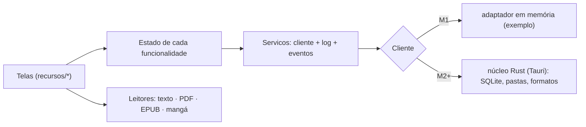

# Fierium

Uma biblioteca pessoal com leitores integrados: os seus livros, PDFs, EPUBs e mangás num lugar que parece seu.
Local e offline, sem conta e sem nuvem. Linux primeiro, depois Windows e Android. **Substitui o
[KOFlibrary](https://github.com/Marcelao98/KOFLibrary)** quando tiver tudo o que ele tem.

> **Em construção.** Onde estamos: **M1 (protótipo de interface + arquitetura) feito, esperando o teste do Marcelo.**
> Próximos: M2 (Tauri no Linux), M3 (os teus livros de verdade), M4 (leitor de PDF). Detalhe: [docs/ROADMAP.md](docs/ROADMAP.md).

## Rodar

Precisa de Node 22+ e pnpm 10 (`npm i -g pnpm@10.28.0`).

```bash
pnpm install
```

```bash
pnpm dev
```

Abre em http://localhost:5180 com a **biblioteca de exemplo** (40 obras de domínio público e duas séries de mangá
inventadas). Atalhos: **Ctrl+K** busca tudo · **Ctrl+Shift+D** inspetor de depuração · `#/vitrine` cada componente
sozinho · `?novo=1` recomeça do zero.

| Comando | O que faz |
|---|---|
| `pnpm check` | formato, lint (com as regras de camadas), tipos e testes de unidade |
| `pnpm e2e` | testes de fluxo no Chromium, com prints em `apps/app/e2e/prints/` |
| `pnpm build` | gera o app web em `apps/app/dist/` |

## Arquitetura em uma figura



Regra de negócio só no Rust; cada funcionalidade isolada na sua pasta (o lint barra uma importar outra); dependências
injetadas; leitores como motores trocáveis; log central com inspetor. Detalhe: [docs/ARQUITETURA.md](docs/ARQUITETURA.md).

## Documentação

| | |
|---|---|
| [Visão de produto](docs/FIERIUM_PRODUCT_VISION.md) | o que o Fierium quer ser (e a Alma dele) |
| [Plano de engenharia](docs/PLANO.md) | processo, qualidade, testes, versões, riscos |
| [Roadmap](docs/ROADMAP.md) | os marcos em checklist, com os checkpoints |
| [Arquitetura](docs/ARQUITETURA.md) · [Modelo de dados](docs/MODELO_DE_DADOS.md) · [Contratos](docs/CONTRATOS.md) | como é montado |
| [Como estender](docs/EXPANDIR.md) | comando, funcionalidade, formato novo; como achar defeito |
| [Decisões](docs/DECISOES.md) · [Jornal](docs/JORNAL.md) | o porquê, e o que aconteceu em cada sessão |
