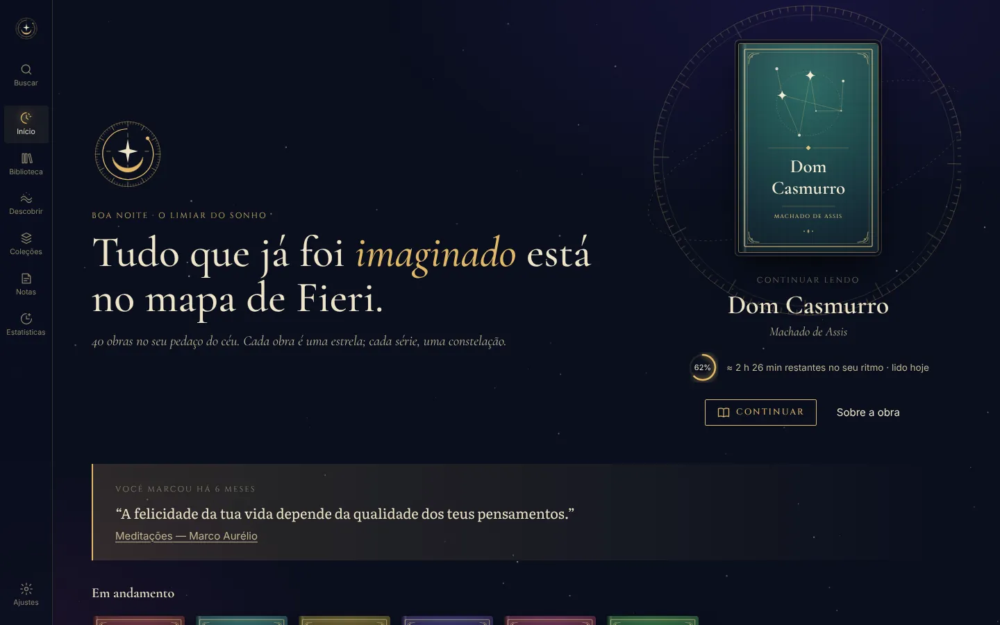
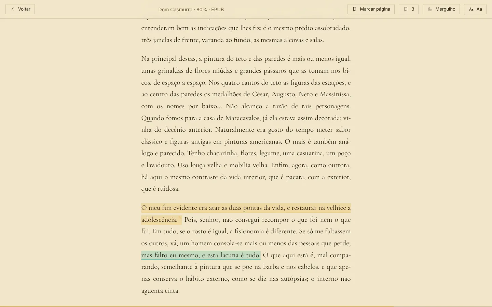
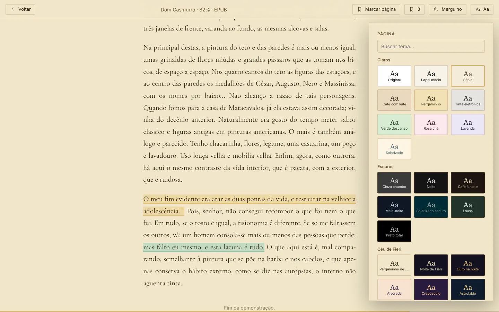
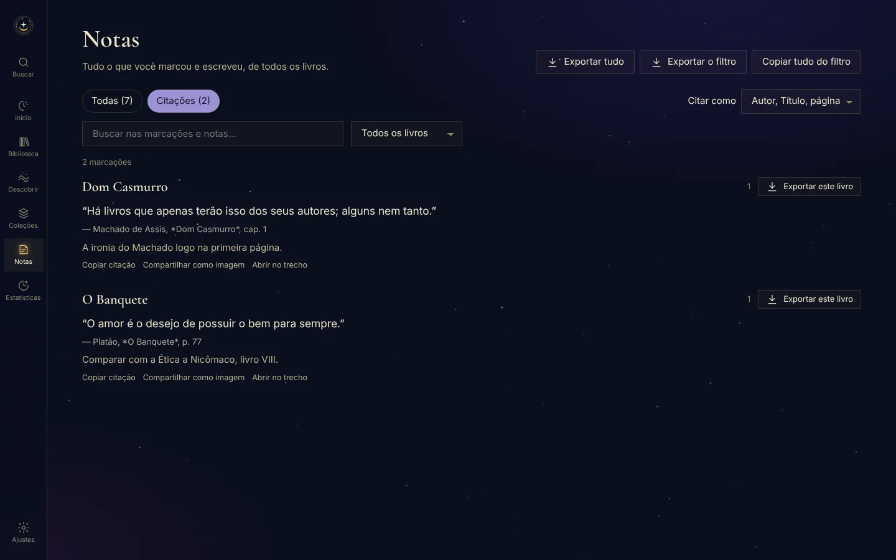
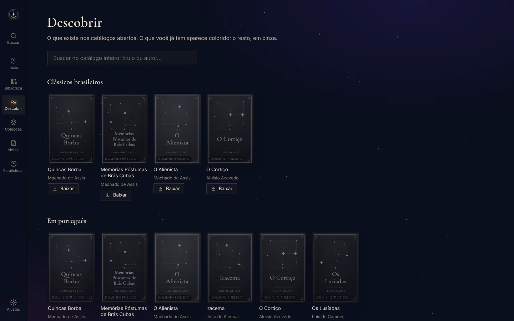
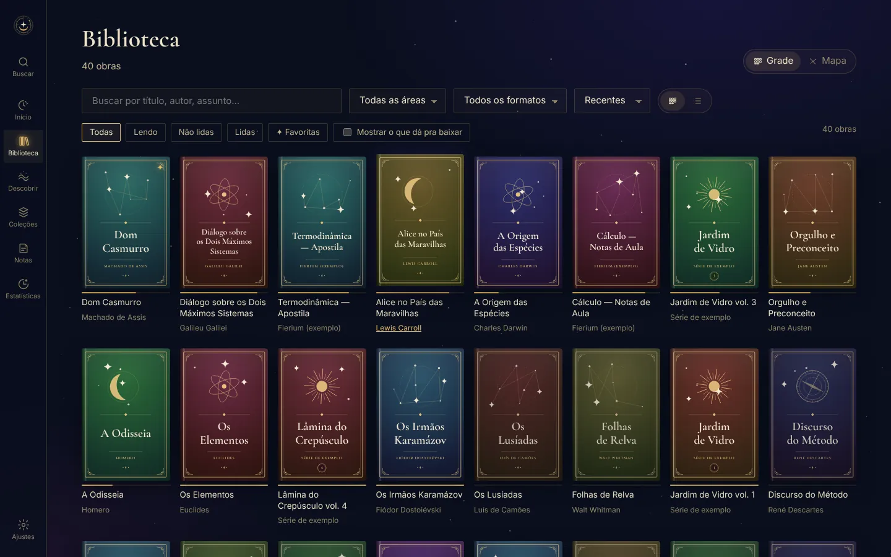
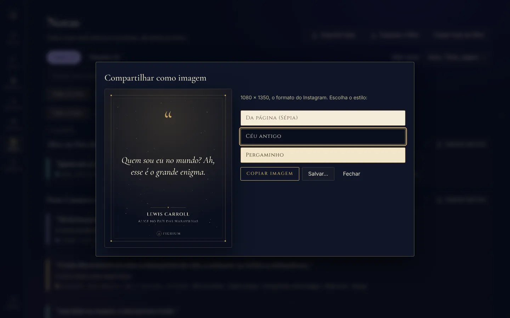

<p align="center">
  
</p>

<h1 align="center">Fierium</h1>

<p align="center">
  <em>Tudo que já foi imaginado está no mapa de Fieri.</em><br>
  Sua biblioteca pessoal: leitor de PDF e EPUB, notas e citações. Offline, sem conta, sem nuvem.
</p>

<p align="center">
  <a href="https://marcelao98.github.io/Fierium/">Site</a> ·
  <a href="https://github.com/Marcelao98/Fierium/releases/latest">Baixar</a> ·
  <a href="docs/INSTALAR.md">Como instalar</a> ·
  <a href="CHANGELOG.md">Novidades</a>
</p>

<p align="center">
  
</p>

## Baixar

Windows (`.exe`) e Linux (AppImage, `.rpm`, `.deb`) na página de
[Releases](https://github.com/Marcelao98/Fierium/releases/latest). No Windows, o SmartScreen pode avisar (o
instalador não tem certificado pago): **Mais informações → Executar assim mesmo**. Passo a passo em
[docs/INSTALAR.md](docs/INSTALAR.md). Depois de instalado, o Fierium avisa sozinho quando sai versão nova.

## O que ele faz

<table>
  <tr>
    <td width="50%"><br><sub><b>PDF e EPUB</b> no mesmo leitor, com progresso salvo</sub></td>
    <td width="50%"><br><sub><b>100 temas de página</b>, mais cor de papel e de letra livres</sub></td>
  </tr>
  <tr>
    <td><br><sub><b>Notas e citações</b>: marque em cores, copie em ABNT, exporte em Markdown</sub></td>
    <td><br><sub><b>Catálogo de clássicos</b> (Projeto Gutenberg): baixar e ler</sub></td>
  </tr>
  <tr>
    <td><br><sub><b>Capas bonitas</b>, até pra livro sem capa</sub></td>
    <td><br><sub><b>Cartão de citação</b> 1080×1350 pra compartilhar</sub></td>
  </tr>
</table>

## Privacidade

Sem conta. Funciona offline (a internet só é usada pelo catálogo, quando você pede, e dá pra desligar). Notas,
marcações e progresso ficam no seu computador. O Fierium só lê os seus livros: nunca altera os seus arquivos.

## Rodar pra desenvolver

Precisa de **Node 22+**, **pnpm 10** e, pro programa de verdade, **Rust (rustup)** e as bibliotecas do Tauri
(Fedora: `sudo dnf install webkit2gtk4.1-devel gtk3-devel librsvg2-devel libsoup3-devel`; Ubuntu/Debian:
`sudo apt install libwebkit2gtk-4.1-dev libgtk-3-dev librsvg2-dev libsoup-3.0-dev`).

```bash
pnpm install
pnpm dev          # a interface no navegador, com a biblioteca de exemplo
pnpm tauri dev    # o programa de verdade (Rust + interface)
pnpm check        # formato, lint, tipos e testes   (pnpm check:rust pro Rust, pnpm e2e pros fluxos)
```

Os prints e o vídeo do site saem de `node ferramentas/vitrine/prints.mjs`; o site (`site/`) é publicado no GitHub
Pages pelo workflow `site.yml`. Arquitetura, decisões e roadmap: [ARQUITETURA](docs/ARQUITETURA.md),
[DECISOES](docs/DECISOES.md), [ROADMAP](docs/ROADMAP.md), [IDENTIDADE](docs/IDENTIDADE.md) e a
[visão de produto](docs/FIERIUM_PRODUCT_VISION.md). Agentes de IA: comecem pelo [AGENTS.md](AGENTS.md).

## Licença

Ainda em aberto (D14 em [docs/DECISOES.md](docs/DECISOES.md)): até o dono decidir, nenhum uso está liberado além
de ler o código.

O Fierium não inclui nem indica onde baixar livros protegidos; os clássicos do catálogo são de domínio público.
