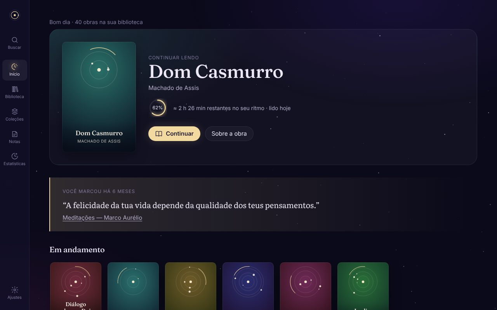
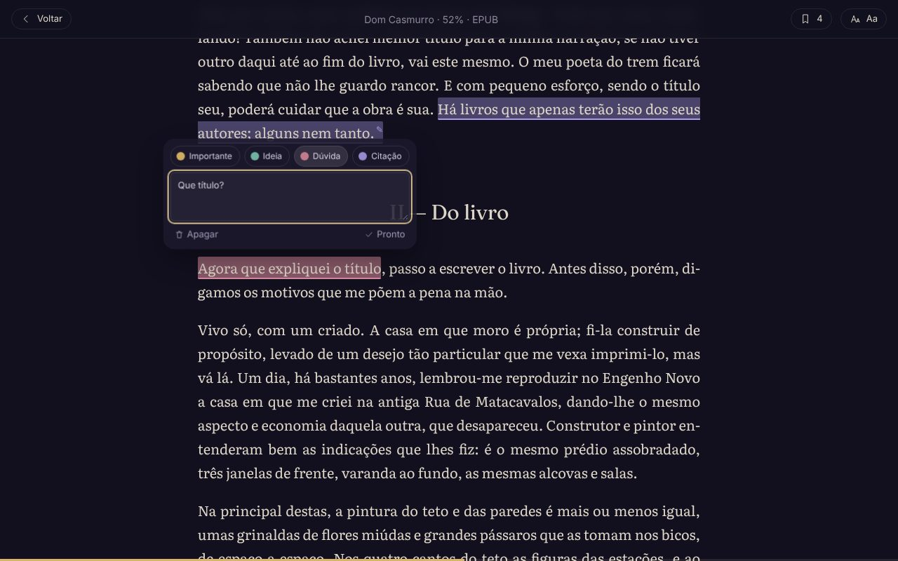
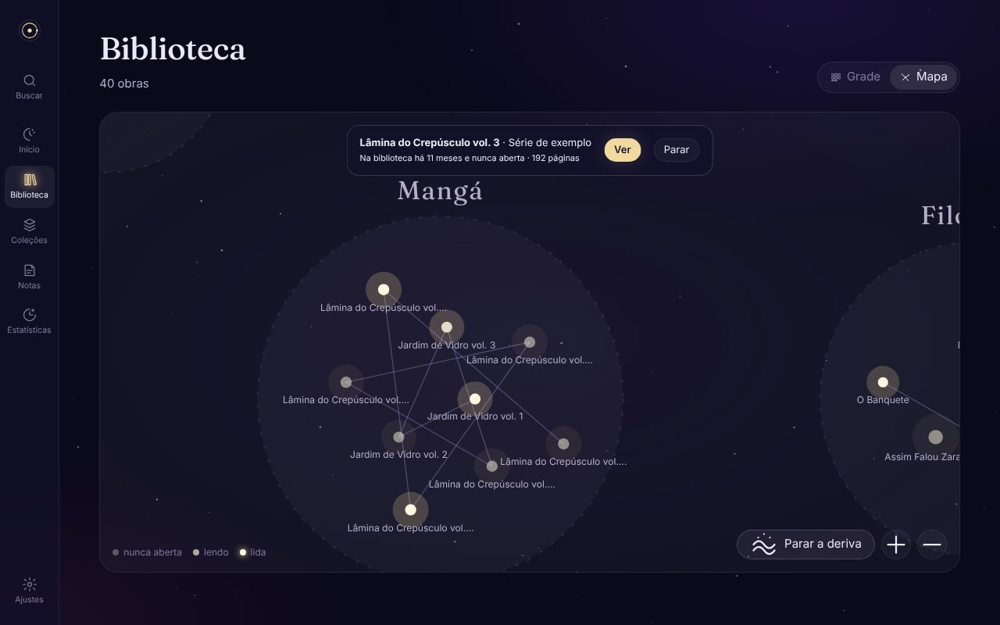
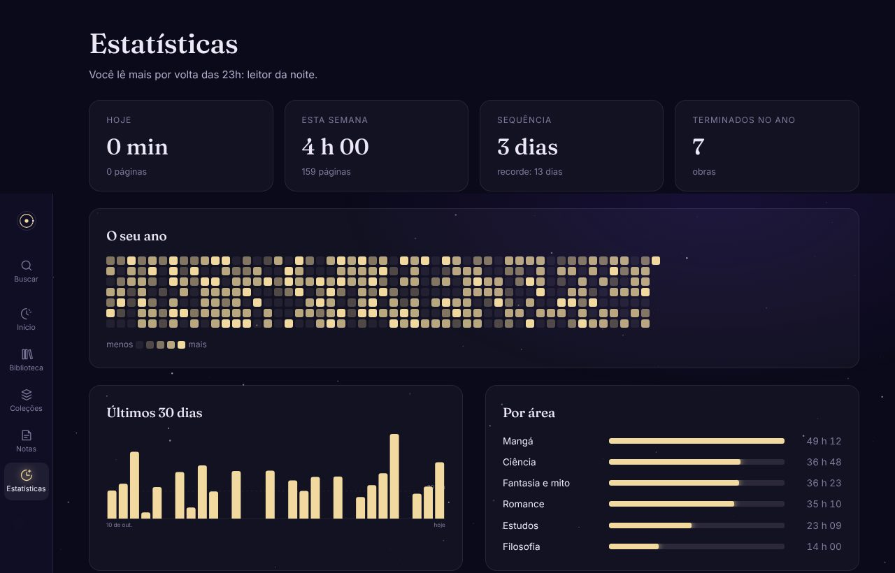
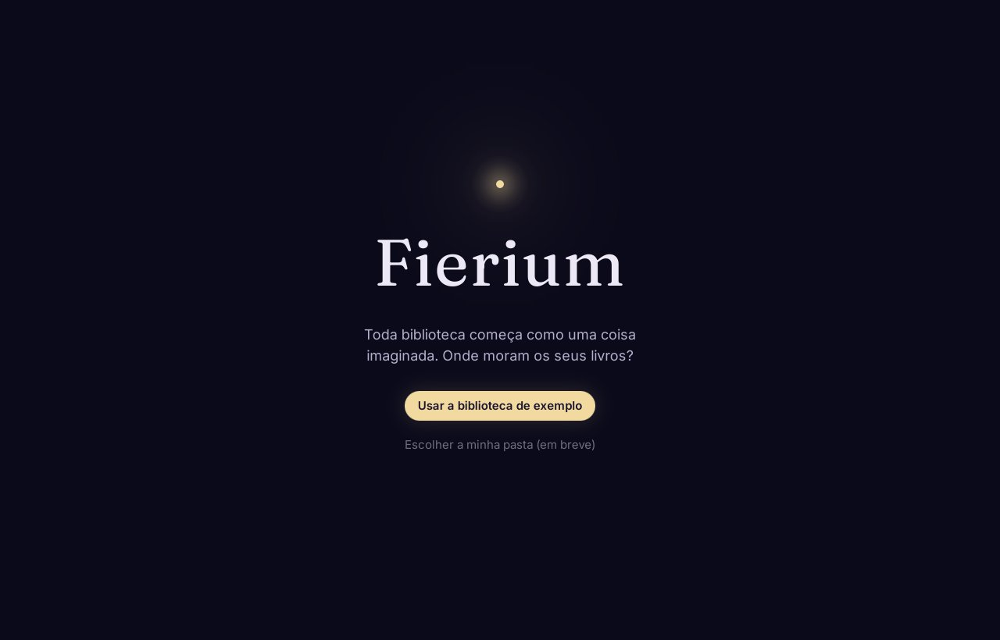
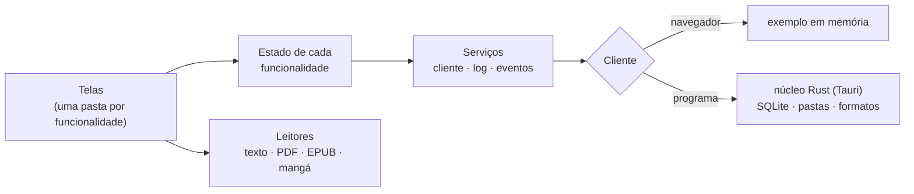

<p align="center">
  
</p>

<h1 align="center">Fierium</h1>

<p align="center">
  <em>A biblioteca de tudo que já foi imaginado.</em><br>
  Os seus livros, PDFs, EPUBs e mangás num lugar que parece seu: local, offline, sem conta e sem nuvem.
</p>

<p align="center">
  
  
  
  
  
</p>

<p align="center">
  
</p>

---

## O que é

**Fieri** é a primordial dos sonhos e da imaginação: de onde vem tudo que um dia foi imaginado. **Fierium** é o
lugar dela, a biblioteca de tudo que existe. Aqui, a sua coleção não é uma pasta de arquivos: é a sua parte desse
céu. Cada área é um mundo, cada obra é uma estrela, cada série é uma constelação, e ler é atravessar a estrela.

Na prática, é uma **biblioteca pessoal com leitores integrados**:

- **Obras, não arquivos.** *Dom Casmurro* em EPUB, um PDF escaneado e o audiolivro são **uma obra** com três jeitos de viver.
- **Ler sem distração.** A interface some enquanto você lê; temas de papel, sépia, noite e tinta.
- **Marcar e pensar.** Cores com o significado que você der, notas, ligações entre trechos de livros diferentes,
  tudo exportável em Markdown.
- **Estatísticas sem culpa.** Tempo, sequência (hoje sem leitura não quebra), metas que você escolhe.
- **Seu, pra sempre.** Funciona sem internet, sem conta, e nunca altera os seus arquivos.

O Fierium vai **substituir o [KOFlibrary](https://github.com/Marcelao98/KOFLibrary)** quando fizer tudo o que ele faz.

## Como está agora

<table>
  <tr>
    <td width="50%"></td>
    <td width="50%"></td>
  </tr>
  <tr>
    <td align="center"><sub>Marcação dinâmica: cada cor tem o seu significado</sub></td>
    <td align="center"><sub>O mapa: a biblioteca como um céu, e a deriva</sub></td>
  </tr>
  <tr>
    <td></td>
    <td></td>
  </tr>
  <tr>
    <td align="center"><sub>Estatísticas e o calendário do ano</sub></td>
    <td align="center"><sub>Rodando como programa de verdade no Linux</sub></td>
  </tr>
</table>

> **Próximo passo: a identidade de Fieri ([M1.5](docs/IDENTIDADE.md)).** O visual de hoje ainda é "um app escuro
> com estrelas". O próximo marco traz a nebulosa viva, os mundos com cor própria, as capas como artefatos de luz e o
> Selo de Fieri lá em cima.

## Roadmap

Cada marco termina num checkpoint: o Marcelo testa no Linux dele e só então o próximo começa.
Checklist completo em [docs/ROADMAP.md](docs/ROADMAP.md).

| | Marco | |
|---|---|---|
| ✅ | **M0** Fundação e plano | monorepo, regras de camada, CI, documentação |
| ✅ | **M1** Interface e arquitetura modular | início, biblioteca (grade, lista, mapa), obra, coleções, leitor, notas, estatísticas |
| ✅ | **M2** Programa Linux (Tauri 2) | núcleo Rust, log em arquivo, arquivo aos pedaços, `.deb` e AppImage |
| ⏭️ | **M1.5** Identidade de Fieri | o sonho, os mundos, as constelações, o selo |
| ⬜ | **M3** Biblioteca de verdade | SQLite, as suas pastas, capas e metadados |
| ⬜ | **M4** Leitor de PDF | páginas sob demanda, temas que repintam a página, PDFs escaneados |
| ⬜ | **M7 · M8** Marcações e estatísticas reais | no PDF, com a sua leitura de verdade |
| ⬜ | **M5 · M6** EPUB e mangá | CBZ e CBR, direita → esquerda, séries |
| ⬜ | **M9 · M10** Backup, importar o KOFlibrary, v1.0 Linux | atualização assinada |
| ⬜ | **M11–M13** Windows, Android, sincronia | e aí o KOFlibrary se aposenta |

## Como é feito



- **Regra de negócio só no Rust**; a interface mostra e pede.
- **Cada funcionalidade isolada** na sua pasta: o lint barra uma importar a outra; elas conversam por eventos tipados.
- **Dependências injetadas**: cada parte é testável sozinha, sem tela e sem Rust.
- **Leitores como motores trocáveis**: PDF, EPUB e mangá entram sem mexer no resto.
- **Depuração de verdade**: log central, rastro de cada comando e um inspetor (**Ctrl+Shift+D**).

Detalhes em [docs/ARQUITETURA.md](docs/ARQUITETURA.md); receitas pra estender em [docs/EXPANDIR.md](docs/EXPANDIR.md).

## Rodar

Precisa de **Node 22+**, **pnpm 10** (`npm i -g pnpm@10.28.0`) e, pro programa, **Rust pelo rustup** e as bibliotecas
do Tauri:

```bash
sudo apt install libwebkit2gtk-4.1-dev libgtk-3-dev librsvg2-dev libsoup-3.0-dev
```

```bash
sudo dnf install webkit2gtk4.1-devel gtk3-devel librsvg2-devel libsoup3-devel
```

(a primeira linha é pro Ubuntu/Debian, a segunda pro Fedora)

```bash
pnpm install
```

| Comando | O que faz |
|---|---|
| `pnpm dev` | a interface no navegador (http://localhost:5180) com a biblioteca de exemplo |
| `pnpm tauri dev` | o programa de verdade (Rust + interface) |
| `pnpm pacote:linux` | gera `.deb` e AppImage em `target/release/bundle/` |
| `pnpm check` | formato, lint (camadas e fronteiras), tipos e testes da interface |
| `pnpm check:rust` | formato, clippy e testes do Rust |
| `pnpm e2e` | testes de fluxo no Chromium, com prints em `apps/app/e2e/prints/` |
| `sh ferramentas/fumaca-linux.sh` | abre o executável numa tela virtual e confere que a interface falou com o Rust |

Atalhos: **Ctrl+K** busca tudo · **Ctrl+Shift+D** inspetor · `#/vitrine` cada componente sozinho (desenvolvimento) ·
`?novo=1` recomeça o exemplo do zero.

## Documentação

| | |
|---|---|
| [Visão de produto](docs/FIERIUM_PRODUCT_VISION.md) | o que o Fierium quer ser, e a Alma dele |
| [Identidade de Fieri](docs/IDENTIDADE.md) | o sonho, os mundos, o selo (próximo marco) |
| [Plano de engenharia](docs/PLANO.md) | processo, qualidade, testes, versões, riscos |
| [Roadmap](docs/ROADMAP.md) | os marcos em checklist |
| [Arquitetura](docs/ARQUITETURA.md) · [Modelo de dados](docs/MODELO_DE_DADOS.md) · [Contratos](docs/CONTRATOS.md) | como é montado |
| [Como estender](docs/EXPANDIR.md) | comando, funcionalidade ou formato novo; como achar defeito |
| [Decisões](docs/DECISOES.md) · [Jornal](docs/JORNAL.md) | o porquê de cada escolha, e o que aconteceu em cada sessão |

Agentes de IA: comecem por [AGENTS.md](AGENTS.md).

---

<p align="center"><sub>Feito pelo Marcelo, no Linux. Nenhum livro, ROM ou arquivo protegido é distribuído aqui: os testes geram os seus próprios.</sub></p>
