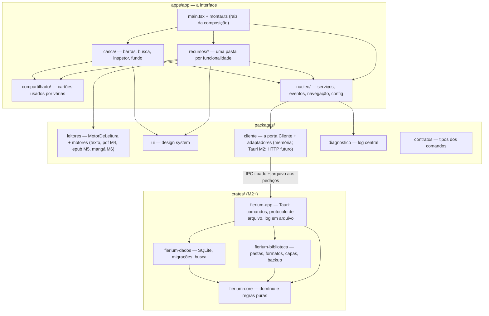
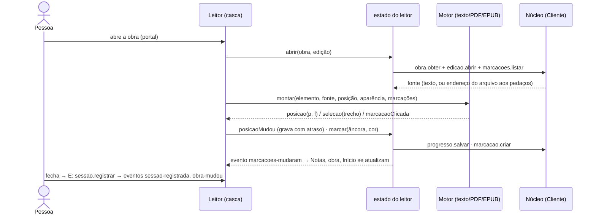

# Arquitetura do Fierium

> Como o Fierium é montado e quem pode falar com quem. O porquê do produto: [FIERIUM_PRODUCT_VISION.md](FIERIUM_PRODUCT_VISION.md).
> Decisões numeradas: [DECISOES.md](DECISOES.md). Como acrescentar coisas: [EXPANDIR.md](EXPANDIR.md).
> Estado de cada parte: [ROADMAP.md](ROADMAP.md).

## 1. Visão geral

Um app só (Tauri 2, a partir do M2): uma **casca nativa em Rust** com o **núcleo** (regras, dados, arquivos) e a
**interface web** (React + TypeScript) numa janela do sistema (WebKitGTK no Linux, WebView2 no Windows, WebView no
Android). Não existe servidor no V1: o "back-end" é o núcleo Rust dentro do app.

**Regra de ouro:** regra de negócio só no Rust; a interface mostra e pede. Até o M3, o adaptador em memória imita o
Rust (mesmos comandos, mesmos erros) pra dar pra construir e testar a interface sem ele.



## 2. Pastas

```
fierium/
├─ apps/app/src/
│  ├─ main.tsx             liga tudo: log, cliente (adaptador), montar(), provedor, App
│  ├─ montar.ts            RAIZ DA COMPOSIÇÃO: cria os serviços e cada funcionalidade (o único que conhece todas)
│  ├─ App.tsx              a rota atual + o leitor por cima + casca
│  ├─ nucleo/              servicos.ts · eventos.ts · navegacao.ts · config.ts · contexto.tsx · avisos.ts
│  ├─ casca/               Navegacao (barras), Busca (Ctrl+K), Inspetor (Ctrl+Shift+D), Atmosfera, Avisos
│  ├─ compartilhado/       Obras (cartão, capa, prateleira), Marcacoes (cartão de marcação, cores)
│  ├─ recursos/
│  │  ├─ inicio/           estado.ts · Tela.tsx · Abertura.tsx · inicio.css
│  │  ├─ biblioteca/       estado.ts · Tela.tsx · Mapa.tsx · ceu.ts (o céu, puro) · testes
│  │  ├─ obra/  colecoes/  notas/  estatisticas/  ajustes/
│  │  └─ leitor/           estado.ts · Tela.tsx (a casca do leitor) · Balao.tsx (marcação, igual pra todo formato)
│  ├─ plataforma/          escolher o adaptador (só o main.tsx usa)
│  ├─ dev/Vitrine.tsx      cada componente sozinho (#/vitrine, só em desenvolvimento)
│  └─ testes/apoio.ts      serviços de teste (cliente em memória, relógio parado, avisos guardados)
├─ packages/
│  ├─ contratos/           os tipos e os comandos (provisório; gerado do Rust a partir do M3 — D6)
│  ├─ cliente/             Cliente + rastrear() + memoria/ (base, obras, colecoes, leitura, marcacoes, estatisticas, config, busca)
│  ├─ leitores/            motor.ts (a tomada) + texto/ (+ pdf/ no M4, epub/ no M5, manga/ no M6)
│  ├─ ui/                  tokens.css, Icone, Selo, Anel
│  └─ diagnostico/         criarLog, relatorio, textoDoErro
└─ crates/ (M2+)           fierium-core · fierium-dados · fierium-biblioteca · fierium-app
```

## 3. Quem pode falar com quem (o ESLint barra o resto)

| Peça | Pode usar | Não pode usar |
|---|---|---|
| `contratos`, `diagnostico` | nada do projeto | tudo |
| `cliente` | contratos, diagnostico | React, ui, leitores |
| `leitores` | contratos (e o DOM) | React, cliente, ui |
| `ui` | contratos, React | cliente, leitores, estado |
| `nucleo/`, `casca/`, `compartilhado/` | cliente (só o núcleo), diagnostico, ui, contratos | **recursos**, plataforma |
| `recursos/x/` | nucleo, compartilhado, ui, leitores, contratos | **outro recurso**, o cliente direto, plataforma |
| `main.tsx`, `montar.ts`, `App.tsx` | tudo | — |

## 4. Como as peças ficam isoladas

### 4.1 Injeção de dependências
`montar(cliente)` cria `Servicos = { chamar, log, eventos, agora, avisar }` e entrega a cada funcionalidade:
`criarBiblioteca(servicos) → { store, carregar, filtrar, … }`. As telas recebem a sua funcionalidade por props
(`<TelaBiblioteca biblioteca={…} />`) e leem com `useFatia(store, seletor)`. Nos testes:
`servicosDeTeste()` (cliente em memória, relógio parado, avisos guardados) e a store é testada sem tela e sem Rust.

### 4.2 Eventos entre funcionalidades
Uma funcionalidade nunca importa outra. Quando algo muda que interessa às outras, ela emite (tipado em
`nucleo/eventos.ts`): `obra-mudou`, `marcacoes-mudaram`, `sessao-registrada`, `colecoes-mudaram`. Ex.: o leitor fecha
→ `sessao-registrada` + `obra-mudou` → Início, Biblioteca, página da obra e Estatísticas se atualizam sozinhos.

### 4.3 A porta do núcleo (`Cliente`)
Uma interface (`chamar(cmd, args)`), vários adaptadores: memória (agora), Tauri (M2), HTTP (futura versão web).
`rastrear(cliente, log)` envolve qualquer adaptador e registra cada comando (nome, argumentos resumidos, tempo, erro).
O adaptador em memória é dividido por área igual aos crates do Rust; o tipo `Tratadores<NomeComando>` garante que
todo comando do contrato tem tratador (faltou um = não compila).

### 4.4 Os leitores (motores)
```
MotorDeLeitura: nome · aceita(fonte) · montar(elemento, { fonte, alvo, aparencia, marcacoes, cores, eventos })
SessaoLeitura:  aplicarAparencia · mostrarMarcacoes · irPara · limparSelecao · desmontar
EventosMotor:   posicao(p, fração) · selecao(trecho+âncora+caixa) · marcacaoClicada · toque · erro
```
A casca do leitor (`recursos/leitor`) é única: barra, véu, temas, painel de marcações e o **balão de marcação**. O
motor só desenha o conteúdo e avisa o que aconteceu. Sem React: cada motor é testável com jsdom.

## 5. Depuração

- **Log central** (`@fierium/diagnostico`): anel dos últimos 500 registros (nível, origem, mensagem, dados). Em
  desenvolvimento também vai pro console; a partir do M2 vai pro arquivo de log do Rust (um por dia), como no KOFstation.
- **Rastro de cada comando** (automático), **cada evento** e **cada erro de tela** (`error`, `unhandledrejection`).
- **Inspetor (Ctrl+Shift+D ou Ajustes → Depuração):** a lista ao vivo, filtro por nível e origem, "copiar relatório".
- **`window.__fierium`** (em desenvolvimento ou com `?depurar`): os serviços e todas as funcionalidades, pra
  investigar pelo console (ex.: `__fierium.recursos.leitor.sessao()`).
- **Erros sempre com código e mensagem em português** (`ErroFierium`), iguais no Rust e na tela.

## 6. Como uma leitura acontece



## 7. Dados

[MODELO_DE_DADOS.md](MODELO_DE_DADOS.md): obra → edição → arquivo; dados pessoais separados dos derivados;
prontos pra sincronizar (UUIDv7, identidade pelo conteúdo, relógio lógico, lápides, regras de juntar por campo).

## 8. Testes

| Nível | Onde | Ferramenta |
|---|---|---|
| Regras e adaptador | `packages/*/src/**/*.test.ts` | Vitest |
| Stores de cada funcionalidade | `recursos/*/estado.test.ts` (com `servicosDeTeste`) | Vitest |
| Motores de leitura | `packages/leitores/**` | Vitest + jsdom |
| Componentes | `*.test.tsx` | Testing Library + jsdom |
| Fluxo | `apps/app/e2e/` (com prints em `e2e/prints/`) | Playwright (Chromium; app Tauri a partir do M2) |
| Rust | `crates/*/tests` | `cargo test` (M2+) |

## 9. Segurança e entrega

Atualização assinada desde o primeiro pacote (D11), chave só no segredo do CI, lançamento por tag. O Rust só expõe
comandos com nome e escopo; permissões do Tauri mínimas. O app nunca altera os arquivos dos livros (D9).
