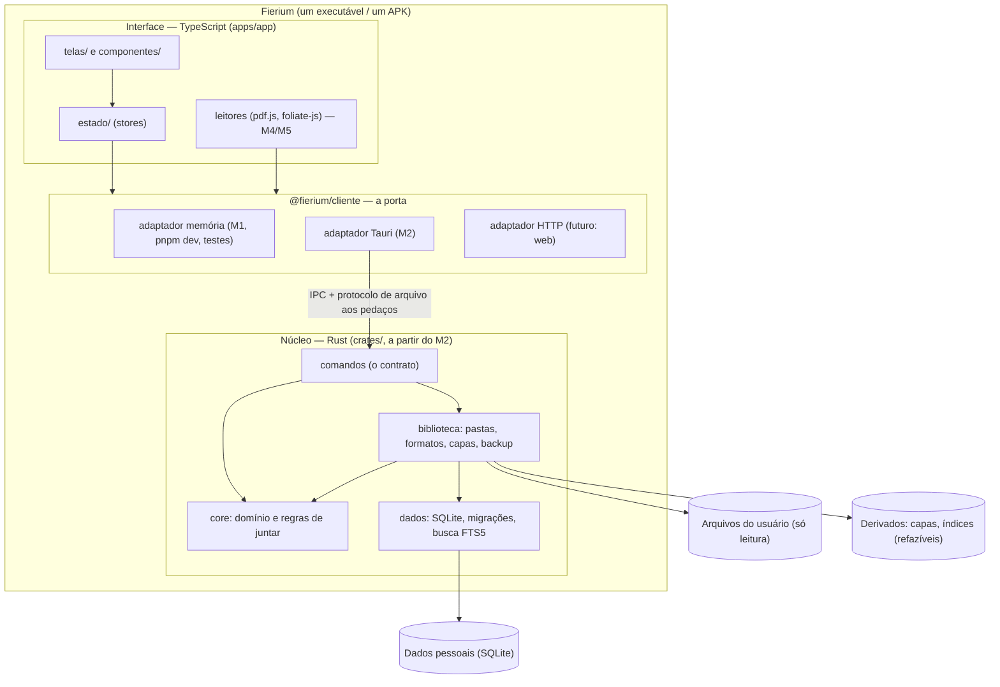
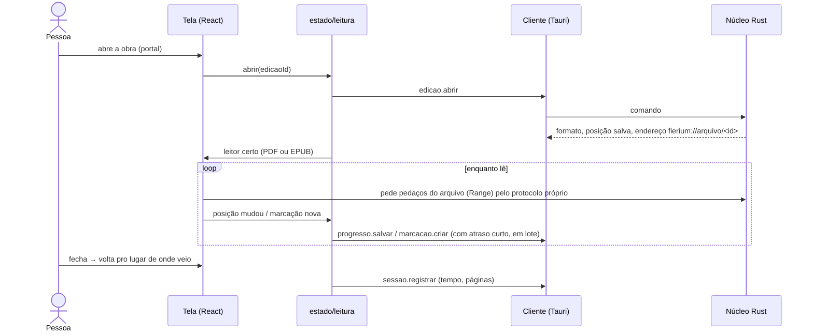

# Arquitetura do Fierium

> Como o Fierium é montado e quem pode falar com quem. A visão de produto (o porquê) está em
> [FIERIUM_PRODUCT_VISION.md](FIERIUM_PRODUCT_VISION.md); as decisões numeradas em [DECISOES.md](DECISOES.md).
> Estado de cada parte: [ROADMAP.md](ROADMAP.md).

## 1. Visão geral

Um app só (Tauri 2): uma **casca nativa em Rust** que tem o **núcleo** (regras, dados, arquivos) e mostra a
**interface web** (React + TypeScript) numa janela do sistema (WebKitGTK no Linux, WebView2 no Windows, WebView no
Android, WKWebView no iOS). Não existe servidor no V1: o "back-end" é o núcleo Rust dentro do app.



## 2. Pastas

```
fierium/
  apps/app/                 o app (Vite + React); src-tauri/ entra no M2
    src/telas/              uma pasta por tela (Limiar, Biblioteca, Obra, Leitor, Marginalia, Cronica, Ajustes…)
    src/componentes/        peças da casca (barra lateral, Invocar, cartões…)
    src/estado/             stores (Zustand): falam com o cliente; as telas só falam com elas
    src/plataforma/         escolhe o adaptador (memória, Tauri)
    e2e/                    testes de fluxo (Playwright)
  packages/ui/              design system: tokens (cores, fontes, espaço, movimento), ícones, selos; sem dados
  packages/contratos/       os tipos do contrato (provisório à mão; gerado do Rust a partir do M2/M3 — D6)
  packages/cliente/         a porta Cliente + adaptadores (memória agora)
  crates/                   (M2+) core · dados · biblioteca · comandos · (depois) sincronia, servidor
  docs/
```

## 3. Camadas (conferidas pelo ESLint)

| Camada | Pode usar | Não pode usar |
|---|---|---|
| `@fierium/contratos` | nada | tudo |
| `@fierium/ui` | contratos (tipos), React | cliente, estado, app |
| `@fierium/cliente` | contratos | React, ui, app |
| `apps/app/src/estado` | cliente, contratos | — |
| `apps/app/src/telas`, `componentes` | estado, ui, contratos | **cliente direto, plataforma** |

Regras que valem sempre:
- **Regra de negócio só no Rust** (D4). O adaptador memória imita os comandos (mesmos nomes, argumentos e erros) pra
  dar pra desenvolver a tela sem Rust; quando o comando existir no Rust, o teste de contrato confere que os dois
  respondem igual.
- **Erro tem código e mensagem em português**; `catch` vazio é barrado pelo lint (só com comentário dizendo por quê).
- **O Rust só expõe comandos com nome e escopo** (nada de "ler qualquer caminho" nem shell). Permissões do Tauri
  (capabilities) só com o necessário.

## 4. Como uma leitura acontece (a partir do M4)



## 5. Dados

Detalhes em [MODELO_DE_DADOS.md](MODELO_DE_DADOS.md). Resumo:
- **Três tipos de dado:** arquivos do usuário (nunca alterados, D9), dados pessoais (SQLite, protegidos, com backup e
  exportação) e derivados (capas, índices, cache: refazíveis).
- **Prontos pra sincronizar** (D8): UUIDv7, identidade do arquivo pelo conteúdo, relógio lógico + aparelho, lápides,
  regras de juntar por campo, registro de mudanças.

## 6. Como a arquitetura cresce (sem construir antes da hora)

| Futuro | Entra como |
|---|---|
| Formato novo (mangá, audiolivro, webtoon…) | um adaptador no Rust (ler, capa, metadados) + um leitor na tela, registrados pelo tipo de conteúdo; o resto não muda |
| Sincronia | um crate `sincronia` com transportes (rede local segura, pasta sincronizada, serviço); usa o registro de mudanças e as regras de juntar que já existem |
| Versão web | o mesmo front com o adaptador HTTP; um servidor (Rust, reaproveitando `core` e `dados` com outro banco) |
| Contas e nuvem | só quando o servidor existir; sempre opcionais |

## 7. Segurança e entrega

Atualização assinada desde o primeiro pacote (D11), chave em segredo do CI, lançamento separado do push. Testes de
fluxo e CI em Linux e Windows desde o M0. Nunca commitar livro, chave ou senha.
