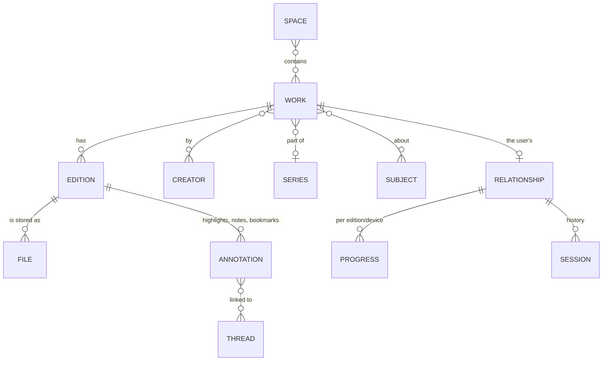
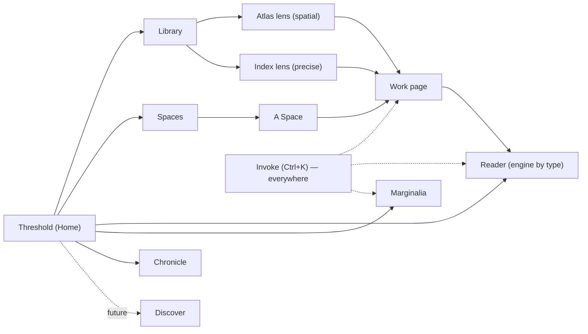
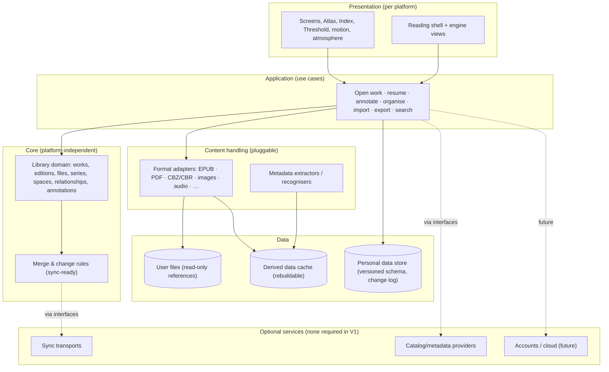

# FIERIUM — Product Vision

*Version 0.1 · concept exploration · 2026-11-07*

> This is a vision document. It explores what Fierium could become. It is not a specification, a V1 scope or a
> technology choice. The V1 scope, the first prototype and the stack are decided **after** this document is reviewed.

**Status labels used throughout:**

| Label | Meaning |
|---|---|
| **[Confirmed]** | An explicit decision from the product owners (the original brief or the addendum). Not up for change in this document |
| **[V1]** | Expected in the first release (only where the owners already said so) |
| **[Proposed]** | My recommendation; needs review |
| **[Future]** | A possibility for later versions, not a commitment |
| **[Experimental]** | Worth prototyping before believing in it |
| **[Open]** | An unresolved question (collected in §21) |

---

## Contents

1. [Executive summary](#1-executive-summary)
2. [Product identity and meaning](#2-product-identity-and-meaning)
3. [The Soul of Fierium](#3-the-soul-of-fierium)
4. [Core philosophy](#4-core-philosophy)
5. [Target experience](#5-target-experience)
6. [Proposed user journeys](#6-proposed-user-journeys)
7. [Main product areas](#7-main-product-areas)
8. [Potential features and interactions](#8-potential-features-and-interactions)
9. [Visual identity and atmosphere](#9-visual-identity-and-atmosphere)
10. [Navigation and information architecture](#10-navigation-and-information-architecture)
11. [Media and reading experiences](#11-media-and-reading-experiences)
12. [Target platforms and deployment strategy](#12-target-platforms-and-deployment-strategy)
13. [Offline-first product philosophy](#13-offline-first-product-philosophy)
14. [Local data ownership and future synchronization](#14-local-data-ownership-and-future-synchronization)
15. [Technical complexity and media handling](#15-technical-complexity-and-media-handling)
16. [Architectural principles derived from the requirements](#16-architectural-principles-derived-from-the-requirements)
17. [Future online platform possibilities](#17-future-online-platform-possibilities)
18. [Intended audience and initial business direction](#18-intended-audience-and-initial-business-direction)
19. [Long-term ecosystem possibilities](#19-long-term-ecosystem-possibilities)
20. [Differentiation from existing products](#20-differentiation-from-existing-products)
21. [Open questions and unresolved decisions](#21-open-questions-and-unresolved-decisions)
22. [Appendix A — Idea triage](#appendix-a--idea-triage)
23. [Appendix B — Lessons carried over from KOFlibrary](#appendix-b--lessons-carried-over-from-koflibrary)

---

## 1. Executive summary

**Fierium is a personal realm for the works you carry with you:** books, studies, manga, comics, webtoons, audiobooks.
It is a library first and a set of reading experiences second, and it belongs entirely to its user.

The name comes from **Fieri**, a Primordial of Dreams and Magic: the force through which imagined things come into
existence. Fierium translates that into product terms: **your collection is not a folder of files, it is a small
universe that grows as you read, study and imagine.**

The vision rests on five ideas:

1. **Works, not files.** Fierium models *what a thing is* (a work, its editions, its files, its series, its
   creators) separately from *how it is stored*. A novel you own as an EPUB, a PDF scan and an audiobook is **one
   work** with three ways to experience it.
2. **Two lenses on one library.** The **Atlas** is a spatial, exploratory view where works and collections form
   constellations you wander through. The **Index** is a precise, fast view for searching, sorting and managing. Both
   are always one gesture apart. *Dreamlike, never confusing.*
3. **Reading as stepping through a portal.** Opening a work feels like entering it: the interface dissolves, the
   right engine takes over (flowing text, fixed pages, panels, endless scroll, sound), and leaving returns you exactly
   where you were.
4. **A library with memory.** Progress, highlights, notes, sessions and the moments you finished things form a
   continuous personal history (the **Chronicle**) and a cross-library knowledge layer (**Marginalia**). The realm
   visibly accumulates light as it is lived in.
5. **Yours, offline, forever.** [Confirmed] Local-first: no account, no login, no server, no subscription. The data
   stays on the device, in open and exportable formats, and is designed from day one to synchronize later without a
   rewrite.

**Confirmed direction** (from the owners): Windows desktop first, Android second, Linux and iOS later; offline-first;
local storage only in V1; no accounts in V1; no heavy computation; built for other people, not only the creators.

**What this document does not do:** choose a stack, define the V1 feature list or design final screens. It describes
the destination and the principles, so the first steps can be chosen without closing doors.

---

## 2. Product identity and meaning

### 2.1 Fieri and the realm

In the fictional universe, **Fieri** is the Primordial of Dreams and Magic, the origin of everything that comes into
being through imagination. *Fieri* is also Latin for "to become, to come into being". The product inherits both
senses:

- **A place of becoming.** A library is never finished. Each work added, each page read, each note written changes
  the realm.
- **A place between reality and imagination.** Knowledge (treatises, textbooks, essays) and story (novels, manga,
  myths) live side by side, because both are things people imagined into existence.

**Fierium** (the suffix *-ium* means "place of", as in *auditorium* or *planetarium*) is therefore **"the place of
Fieri": the place where imagined things exist.**

### 2.2 The core metaphor: a personal astral library

[Proposed] The single governing metaphor is **a library that exists in a dream-sky.** It is neither a fantasy castle
nor a wooden bookshelf, but a quiet, luminous space:

| Real concept | In Fierium | Why it is more than decoration |
|---|---|---|
| The whole collection | **The Realm** | Your library has one identity, one atmosphere, and grows over time |
| A collection with a purpose | **A Space** (a hall, a wing, a place) | Each space can have its own atmosphere, layout and reading defaults (study vs leisure) |
| A work | **A star / a light** | Light expresses state honestly: unread works are dim, works in progress glow, finished works shine steadily |
| Relationships (same author, subject, series, your links) | **Constellations** | Connections become visible and navigable |
| Opening a work | **A portal** | A spatial transition that protects focus |
| Your history | **The Chronicle** | Time is part of a library's meaning |
| Your notes and highlights | **Marginalia** | Thinking is a first-class citizen, not a hidden sidebar |
| Wandering without a goal | **Drift** | Discovery inside your own collection |

**Language rule** [Proposed]: *poetry in the experience, clarity in the labels.* The visible UI uses plain words
("Library", "Collections", "Notes", "History") with Fierium's names as a second layer (titles, headers, onboarding,
empty states). A new user never has to learn a vocabulary to find their book. (Open question §21.)

### 2.3 What Fierium is not

- Not a **fantasy RPG interface**: no parchment, scroll frames, wooden shelves or medieval ornament.
- Not a **file manager** with a pretty skin.
- Not a **store** or a front-end to a store.
- Not a **social network** with a reader attached.
- Not **"another ebook reader"**: reading engines are essential, but they serve the library and the person.

---

## 3. The Soul of Fierium

*This section defines what must survive every future technical, design or business decision. If a feature
contradicts the soul, the feature loses.*

### 3.1 What it should feel like

- **Arriving somewhere.** Opening Fierium should feel like stepping into a quiet room that was waiting for you, with
  the lights you left on. It should not feel like launching software.
- **Being expected.** The realm remembers. Your last work is there, at the page where you left it, and the realm
  shows that time passed (a faint trail, a note resurfacing).
- **Calm curiosity.** The atmosphere invites wandering, but nothing shouts. There are no badges begging for
  attention, no feeds and no artificial urgency.
- **Depth without weight.** There is always more to discover (connections, forgotten works, old highlights), but it
  reveals itself gradually, never all at once.
- **Ownership.** You should never wonder whether your library belongs to you. It works without the internet, without
  an account, and leaves with you in open formats whenever you want.

### 3.2 Emotions to evoke

Wonder (soft, not spectacular) · belonging · focus · continuity · the pleasure of rediscovery · quiet pride as the
realm grows.

### 3.3 Emotions to avoid

Overwhelm · guilt (shame-driven streaks, nagging) · confusion (beautiful but lost) · noise (constant animation,
notifications) · dependency (fear of losing data, lock-in).

### 3.4 Inviolable principles

1. **The content comes first.** When reading, the work is the protagonist; the atmosphere steps back.
2. **Dreamlike, never confusing.** Every poetic view has a precise, conventional twin one gesture away.
3. **Light is meaning.** Visual effects encode real state (progress, attention, connection), never pure decoration.
4. **The library belongs to the user.** Local-first, offline-capable, exportable, no account required for the core.
5. **No dark patterns.** No manipulative streaks, no engagement bait, no selling attention.
6. **Fierium never modifies or loses the user's files.** It reads them, references them, and asks before touching
   anything.
7. **Beauty is accessible.** Reduced motion, contrast, readable type, keyboard and screen readers are part of the
   design, not exceptions to it.
8. **Fast is part of magical.** A dream that stutters breaks the spell. Performance is a design value.
9. **Growth without rupture.** New media, features and services join the realm; they do not require redesigning it.

---

## 4. Core philosophy

The owners' six principles, plus what each means in practice:

| Principle | What it means in Fierium | Practical consequences |
|---|---|---|
| **Personal ownership** | The user's collection, organisation and history are theirs | Files stay where they are (Fierium references, never hijacks); user data is in open formats with full export; no account for the core [Confirmed] |
| **Immersion** | Atmosphere encourages exploration and deep reading | Portal transitions, reading modes that recede, per-space atmospheres, optional ambient sound |
| **Discovery** | Meet unfamiliar works, subjects and ideas | Drift, constellations, "forgotten stars", resurfacing (Echoes); later, public-domain catalogs |
| **Continuity** | Progress, notes, highlights and history form one experience | A unified personal layer across all media types; Chronicle; later, sync across devices |
| **Flexibility** | Different content needs different experiences | Pluggable reading engines (flow, page, panel, scroll, listen, gallery) behind one consistent shell |
| **Beauty and usability** | Distinctive, but accessible and fast | Design tokens, motion rules, performance budgets, accessibility as a feature |
| **Growth** | Evolve into an ecosystem without redesign | A stable domain model (works / editions / files), extension points for formats and services |

Two additional principles [Proposed]:

- **Honesty.** Statistics, light and growth reflect what really happened. No fake progress, no inflated
  achievements.
- **Respect for attention.** Fierium never interrupts reading. Notifications are off by default and exist only for
  things the user explicitly asked for.

---

## 5. Target experience

### 5.1 The first time (onboarding as a ritual, not a form)

1. **Darkness, then a single light.** A brief, skippable opening (≈3 s): a point of light appears, the word
   *Fierium*, a line such as *"Every world begins as an imagined thing."*
2. **"Where do your worlds live?"** The user points Fierium at one or more folders (or drags them in). This is the
   only required step.
3. **The realm gathers.** As files are found, lights appear and drift into place, grouped by kind (books, manga,
   audio). This is real progress made visible: counts, formats detected, covers arriving. It is not a fake animation.
4. **First choices, all optional:** name your realm, pick an atmosphere (dusk, deep night, dawn…), choose reading
   defaults (manga direction, theme).
5. **You arrive at the Threshold**, with a suggested first action: *"Continue"* if progress was imported (for example
   from a KOFlibrary backup), otherwise *"Begin with…"* and three works chosen thoughtfully (recently added, a
   series start, something short).

### 5.2 Every day

- **The Threshold (home)** opens in under a second, with *the last dream*, your current work, ready to resume in one
  click or tap.
- Around it, quietly: what else is in progress, a resurfaced highlight, something new in the realm, an invitation to
  drift. Never more than a few elements.

### 5.3 Entering a work

- The cover (or a sigil generated for coverless files) **expands into the reading space**. The library dims and
  recedes; the interface fades until needed.
- The appropriate engine opens at the exact position, with the work's own settings (or its space's defaults).
- **Leaving** reverses the motion: the work returns to its place in the realm, slightly brighter if progress was made.

### 5.4 How the interface evolves with the activity

| Activity | Interface posture |
|---|---|
| Exploring | Spatial, atmospheric, more motion and depth (still restrained) |
| Managing / searching | Dense, precise, fast; atmosphere becomes a subtle background |
| Reading | Near-silent: content only, controls on demand, atmosphere reduced to the page tone |
| Studying | Split view: text plus Marginalia; tools visible; calm, high-contrast |
| Listening | Ambient: large artwork, chapter map, minimal controls, works with the screen off |

### 5.5 Growth you can see

- The realm **accumulates light**: finished works shine steadily, much-annotated works gain small satellites
  (notes), and connections you made become visible threads.
- **Seasons of reading** [Experimental]: the Chronicle can tint periods ("the summer of Russian novels") from what
  you actually read.
- No levels, coins or leaderboards. Growth is reflective, not competitive (§3.4).

---

## 6. Proposed user journeys

Each journey names the person, the moment and what Fierium must make effortless.

### J1 — The returning reader (the most important journey)

*Ana opens Fierium on her Windows laptop after a week away.*
1. The Threshold shows *The Brothers Karamazov*, 62%, "≈ 9 h left at your pace".
2. One click → portal → the exact paragraph, with her last highlight subtly marked.
3. She reads 40 minutes and closes. The work drifts back; the Chronicle records the session.

**Must be effortless:** cold start to reading in under 3 seconds and two interactions.

### J2 — The student

*Bruno has a semester of PDFs: textbooks, papers, slides.*
1. He creates a space, *"Thermodynamics — 2027.1"*, with a "study" atmosphere (bright, focused, wide margins).
2. He opens a 900-page PDF textbook: fast page engine, margin cropping, search, table of contents.
3. He highlights, writes notes, and **links a passage to a paper** in the same space (a thread across works).
4. Before the exam, he opens **Marginalia** filtered by the space and exports everything to Markdown.

**Must be effortless:** large PDFs never stall; notes are findable across works; export is complete.

### J3 — The manga reader

*Carla follows several series as .cbz and .cbr volumes.*
1. Series are recognised automatically (title, volume, chapter) and shown as one entity with "37 of 110 read".
2. Right-to-left reading, double pages on wide screens, a single page on the phone.
3. End of chapter → the next chapter opens without returning to the library.
4. On her Android phone (in the future, with sync) she continues on the bus at the same page.

**Must be effortless:** series ordering is always right; page turns are instant.

### J4 — The explorer (Drift)

*Diego owns 2,000 files and has read 10% of them.*
1. He chooses **Drift**: the Atlas slowly moves through regions of his realm and pauses on works he owns but never
   opened ("forgotten stars"), explaining why: *"same author as something you loved"*, *"added 3 years ago"*,
   *"short: 2 h"*.
2. He keeps one for tonight ("set aside") or lets it pass.

**Must be effortless:** serendipity without randomness fatigue; every suggestion explains itself.

### J5 — The curator

*Eva builds a space called "Myths of the World": novels, academic texts, an illustrated edition, an audiobook.*
1. She adds works by dragging them in or with a rule ("subject contains mythology").
2. She arranges them as a **reading path** (an ordered journey), adds a short description and picks an atmosphere.
3. Later [Future] she shares the path (its structure and descriptions, never the files) as a link.

**Must be effortless:** mixing media types inside a space feels natural.

### J6 — The listener

*Felipe listens to audiobooks while walking and reads the same works at home.*
1. The audiobook and the EPUB are **two editions of one work**.
2. Listening on Android: chapters, speed, sleep timer, bookmarks by voice-friendly gestures.
3. [Future] Position handoff between listening and reading when alignment data exists (chapter-level at first).

**Must be effortless:** audio keeps playing reliably in the background; the position is never lost.

### J7 — The first launch (§5.1)

From install to the first page read in under 2 minutes, with no account, no form and no internet.

### J8 — Moving devices or recovering [Proposed for early versions]

*A user changes PCs.* They export the realm (one portable package of their personal data) or point Fierium at a
folder containing a backup, and everything returns: progress, notes, collections, history. Files are matched by
content, not by name.

---

## 7. Main product areas

| Area | Purpose | Contribution to the experience | Status |
|---|---|---|---|
| **The Threshold** (Home) | Resume and orient | The "arriving" moment; continuity | [Proposed] core |
| **The Library** (Atlas + Index lenses) | See, explore and manage everything | Identity (Atlas) plus control (Index) | [Proposed] core |
| **Spaces** (collections) | Meaningful groupings with their own atmosphere | Personalisation; context (study vs leisure) | [Proposed] core |
| **Work page** | Everything about one work: editions, files, series, progress, notes, connections | Turns "a file" into "a work" | [Proposed] core |
| **Reading engines** | Experience each kind of content properly | Immersion, comfort, flexibility | [Confirmed] ambition, [Proposed] staged |
| **Marginalia** (notes & highlights) | A knowledge layer across the library | Study, memory, continuity | [Proposed] core (basic), advanced later |
| **Chronicle** (history & statistics) | Your reading life over time | Growth, reflection, honesty | [Proposed] basic early, rich later |
| **Discover** | Find new works outside the library | Discovery beyond the owned collection | [Future] (needs internet; optional) |
| **Invoke** (command & search) | Reach anything instantly | Speed and accessibility for power users | [Proposed] core |
| **Settings & Data** | Folders, appearance, reading defaults, export/import, privacy | Ownership and trust | [Proposed] core |

---

## 8. Potential features and interactions

Grouped by area. Each feature gets a purpose and a triage (Appendix A consolidates them).

### 8.1 Library and organisation

- **Library roots** — the folders Fierium watches. Files stay in place; changes are detected (added, moved,
  deleted). *Purpose:* ownership, zero migration cost. **Essential.**
- **Automatic work recognition** — from embedded metadata, file names, folder structure and series patterns, grouping
  files into works and editions. The user can always correct it (merge, split, re-link). *Purpose:* "works, not
  files". **Essential.**
- **Smart spaces** — spaces defined by rules (author, subject, format, status, tags) that stay up to date.
  **Optional early, essential later.**
- **Reading paths** — ordered journeys inside a space (curricula, series in chronological order, a personal canon).
  *Purpose:* curation and guided reading. **Optional.**
- **Tags and personal fields** — free tags, ratings, personal summary, "why I own this". **Essential (basic).**
- **Bulk editing** in the Index (multi-select, apply metadata, move to space). **Essential.**
- **Duplicate and edition handling** — the same work in several files is shown once, with a preferred edition per
  device. **Essential** (it follows from the model).

### 8.2 Exploration and discovery inside the library

- **The Atlas** — the spatial view (§10.3). **Essential for identity; scope of V1 open.**
- **Constellations** — automatic (same author, series, subject) and personal (user-drawn links) connections between
  works, visible in the Atlas and on work pages. **Optional early.**
- **Drift** — guided serendipity through the realm with explained suggestions (J4). **Optional;** cheap to build
  once the model exists, and very characteristic of the product.
- **Forgotten stars** — unopened or long-abandoned works resurfaced gently. **Optional.**
- **Echoes** — old highlights resurfacing on the Threshold ("a year ago you underlined…"). **Optional;** strong
  emotional value.
- **Set aside / Next up** — a lightweight queue that is not a to-do list. **Essential (basic).**

### 8.3 Reading (common to all engines)

- **Exact position memory** per edition and per device, with a semantic position when possible (chapter + offset),
  not only page numbers. **Essential.**
- **Reading themes** that respect the content: paper, sepia, night, e-ink, high contrast; for fixed layouts,
  **page recolouring** (a strength proven in KOFlibrary). **Essential.**
- **Focus veil** — controls fade away; a single gesture brings them back. **Essential.**
- **Time and pace awareness** — "≈ 2 h left at your pace", computed from real reading. **Optional.**
- **Text-to-speech** using the system's voices [Proposed early-optional]. Valuable for accessibility.

### 8.4 Marginalia (knowledge layer)

- Highlights (colours with user-defined meanings), notes, bookmarks: one model across EPUB, PDF and comics (regions
  on images). **Essential (basic).**
- **Threads** — link a passage to another passage, work or note across the library. **Optional;** this is what turns
  a reader into a thinking tool.
- **Marginalia view** — all notes, filterable by work, space, tag, colour or date; full-text search. **Essential.**
- **Export** — Markdown (Obsidian/Logseq-friendly), plain JSON; citations with page or location. **Essential.**
- **Review cards** [Future] — turn highlights into spaced-repetition cards for study.

### 8.5 Chronicle (time and memory)

- Sessions, pages, time; finished works with dates; reading calendar. **Essential (basic).**
- **Retrospectives** — month or year in reading, generated locally (KOFlibrary's "cartão do mês" idea, refined).
  **Optional.**
- **Gentle goals** — user-defined, never pushy, no streak-shaming. **Optional.**
- **Moments** [Experimental] — let the user attach a small memory to a finished work ("read during the trip to
  Lisbon"). Builds a personal relationship with the library.

### 8.6 Atmosphere

- **Per-space atmospheres** — colour field, light, motion intensity, optional ambient sound; derived from the
  space's covers or chosen. **Optional early.**
- **Time-aware light** [Optional] — the realm is slightly warmer at night and brighter by day (respecting the system
  theme).
- **Ambient soundscapes** [Future] — rain, library hush, night sky; generated or bundled; never auto-playing by
  default.

### 8.7 Invoke (command palette)

Ctrl+K / a search gesture: works, authors, spaces, notes, commands ("open the last manga", "export notes of this
space"). **Essential;** keeps the poetic UI fast for experts.

---

## 9. Visual identity and atmosphere

### 9.1 Principles

1. **Light is the main material.** Fierium is designed with light, not ornament: glows, gradients, depth of field,
   soft luminous edges.
2. **Depth over decoration.** Layers (foreground UI, middle content, deep background field) create the "slightly
   removed from reality" feeling.
3. **Restraint.** The more dramatic an effect, the rarer it is (portals: yes; sparkles on buttons: never).
4. **The content's own colours lead.** Covers and art tint their surroundings; the UI adapts to the work, not the
   other way round.

### 9.2 Palette (direction, not final)

| Role | Direction |
|---|---|
| Deep field | Not pure black: deep ink-indigo to night violet, with slight noise for depth |
| Primary light | Warm starlight (pale gold / champagne) for focus and progress |
| Dream accents | Muted violet, aurora teal, dusk rose, used sparingly for spaces and states |
| Text | Off-white on dark; warm near-black on light |
| Light mode ("Lucid") | Dawn and paper tones (pearl, mist, soft sky) with the same accents |

Both a dark (night) and a light (lucid) identity are required. Night is the signature, but it must not be the only
mode.

### 9.3 Typography

- **Display / titles:** an elegant, literary serif with good weight range (titles of works deserve dignity).
- **Interface:** a humanist sans-serif, highly legible at small sizes, with excellent multilingual coverage
  (Portuguese, Japanese titles for manga, and so on).
- **Reading:** a curated set of reading fonts (serif, sans, dyslexia-friendly, monospace), user-adjustable.
- Typography carries much of the immersion: generous spacing, careful hierarchy, quiet labels.

### 9.4 Motion

- **Two speeds.** *Functional* motion is fast (≤ 200 ms: hovers, menus, page turns). *Spatial* motion is slow and
  eased (400–900 ms: entering a space, portal transitions, drift), and is always interruptible.
- **Nothing moves without a reason** (a state change, navigation, or ambient field at very low intensity).
- **Reduced motion** replaces spatial motion with crossfades; ambient fields become static.

### 9.5 Iconography, shapes and sigils

- Thin-line icons with celestial geometry (circles, arcs, orbits), never fantasy symbols.
- **Sigils** [Proposed]: works without covers get a generated, deterministic mark (from title and author): beautiful
  placeholders instead of grey rectangles. This is also a recognisable part of the Fierium identity.

### 9.6 Sound (optional)

Very soft UI tones for portal open/close and achievements of real meaning, off by default. Audio identity matters
for the listening experience.

### 9.7 What to avoid

Parchment, wood, candles, scroll frames, runes, RPG health-bar aesthetics, glitter, constant particles, 3D page curl
gimmicks, skeuomorphic shelves, neon overload.

---

## 10. Navigation and information architecture

### 10.1 The conceptual model (the backbone of everything)

| Concept | Definition | Example |
|---|---|---|
| **Work** | The abstract creation | *Dom Casmurro* by Machado de Assis |
| **Edition** | A specific expression of it: language, translation, publisher, format family, audio narration | The 1899 Garnier text; an English translation; an audiobook narrated by X |
| **File** | The physical digital item on a device | `dom_casmurro.epub`, `dom-casmurro-scan.pdf`, `dc-audio/*.m4b` |
| **Series** | An ordered set of works or volumes | *One Piece*, volumes 1–110 |
| **Creator** | Author, translator, illustrator, narrator, etc. | — |
| **Space** | A user collection with atmosphere and rules | "Brazilian classics" |
| **Relationship** | Everything personal about the user and a work | Status, rating, progress, sessions, moments |
| **Annotation** | Highlight, note or bookmark anchored to a location in an edition | — |

This follows the long-tested library-science idea (FRBR/LRM: work → expression → manifestation → item), simplified
for people. **It is the single most important structural decision in the vision** [Proposed]. It enables editions,
audiobook and text pairs, duplicates and future catalogs without redesign.

### 10.2 Top-level map

- **The Reader is a mode, not a page.** It overlays everything and returns to the origin.
- **Invoke is global** (command palette and universal search).
- **Desktop:** a slim, collapsible side rail (Threshold, Library, Spaces, Marginalia, Chronicle) plus Invoke.
- **Mobile:** a bottom bar with four destinations (Home, Library, Notes, History), and Spaces inside Library. Reading
  is full-screen.

### 10.3 The two lenses

**Atlas (exploration)** [Proposed; V1 scope open]
- A 2D (not 3D) luminous field where spaces are regions and works are lights. You pan, zoom and drift.
- Zooming in changes the level of detail: realm → spaces → series/constellations → individual works (covers appear).
- Positions are **stable and meaningful**: arranged by space, then by relationships (author, series, subject, links),
  so your realm has a geography you learn and remember.
- Always offers the way out: a toggle to the Index with the same selection and filters.

**Index (control)** [Proposed core]
- Grid and list, sort, filter, facets (format, status, space, language, tags), multi-select, bulk edit.
- Built for 10,000+ items with instant search.

**Why two lenses:** the Atlas gives the product its soul and makes discovery spatial; the Index guarantees usability
and speed. Neither is an afterthought, and the same selection flows between them.

### 10.4 Search

- One search box (Invoke) across titles, creators, series, subjects, tags, **notes and highlights**, and (later)
  full text inside works.
- Accent-insensitive, typo-tolerant, multilingual (a KOFlibrary strength to keep).

---

## 11. Media and reading experiences

[Confirmed] ambition: books, novels, academic/technical, scientific/philosophical, PDF, EPUB, manga/comics, webtoons,
image-based publications, audiobooks. [Proposed] each family gets an **engine** built on a shared reading shell.

| Engine | Content | Key experience | Specific needs |
|---|---|---|---|
| **Flow** | EPUB, reflowable text, TXT/Markdown/HTML (later FB2, MOBI/AZW3 without DRM) | Typography is the immersion: fonts, size, spacing, margins, justification, hyphenation; scroll or paginated; columns on wide screens | Semantic positions (CFI-like) for exact resume and annotation anchoring |
| **Page** | PDF, fixed-layout EPUB, DjVu (later) | Fast rendering of large documents, zoom, fit modes, margin crop, two-page spreads, page recolouring themes, outline/TOC, search | Lazy, tiled rendering; must never load whole files into memory |
| **Panel** | Manga, comics (CBZ, CBR, folders of images, PDF comics) | RTL/LTR, double pages, spread detection, auto series continuation, optional panel-by-panel [Experimental] | Image decoding off the main thread; prefetch; archive streaming |
| **Scroll** | Webtoons / manhwa | Continuous vertical strip, seamless chapter joins, smooth momentum | Memory-bounded image pipeline |
| **Listen** | Audiobooks (M4B, MP3 folders, later others) | Chapters, speed, skip, sleep timer, background playback, car/lock-screen controls, bookmarks with notes | OS media integration; precise position storage |
| **Gallery** | Artbooks, photo books, image publications | Large-image viewing, zoom, slideshow, contemplative presentation | High-resolution decoding, tiling |

**Shared across engines:** the shell (controls, focus veil, themes), the position model, annotations, sessions,
accessibility (TTS, contrast, keyboard), and handoff between editions.

**Cross-media magic** [Future/Experimental]:
- **Text ↔ audio handoff:** switch from reading to listening at the same place (chapter-level first; sentence-level
  when alignment data exists, such as EPUB 3 media overlays).
- **Illustrated editions alongside text:** open the art of a passage in a side view.

**Explicitly out of scope** [Proposed]: DRM-protected files from stores. Fierium handles DRM-free content the user
owns. (Policy question in §21.)

---

## 12. Target platforms and deployment strategy

### 12.1 Confirmed requirements

| Platform | Priority | Status |
|---|---|---|
| **Windows** | Primary | [Confirmed] first focus |
| **Android** | Second major priority (continue the library and reading on mobile) | [Confirmed] second focus |
| **Linux** | Long-term compatibility | [Confirmed] later |
| **iOS** | Long-term compatibility | [Confirmed] later |

[Confirmed] The architecture must avoid platform-specific coupling so that Linux and iOS do not require rebuilding the
application.

### 12.2 How desktop and mobile should differ (one identity, two postures)

| Aspect | Desktop (Windows first) | Android |
|---|---|---|
| Main role | The **home of the realm**: building, curating, exploring, studying | **Continuity**: reading, listening, quick notes, light browsing |
| Navigation | Side rail, Invoke, keyboard shortcuts, multi-pane (reader + Marginalia) | Bottom bar, gestures, one pane at a time, bottom sheets |
| Atlas | Full spatial exploration | Simplified (a constellation view per space), touch-first |
| Reading | Wide layouts, two-page spreads, split study view | Full-screen, tap zones, volume-key page turns, one-handed use |
| Library roots | Arbitrary folders and drives | System-mediated folder access plus app storage |
| Listening | Secondary | Primary (background playback, lock screen, headphones) |
| Atmosphere | Richer depth and motion | Lighter, battery-aware |

**Identity constants across platforms:** palette and light language, typography, the portal transition, sigils,
vocabulary, and the data model.

### 12.3 Deployment strategy (principles, not tools)

- [Proposed] **Signed releases from day one** on every platform; update checks verify signatures before applying
  anything (lesson from KOFlibrary, Appendix B).
- [Proposed] Windows: a normal installer and a portable option; optional auto-update, signed. Android: Play Store as
  the target channel, with a signed direct-download APK as an option. Linux later (an AppImage/Flatpak-class format).
  iOS later (App Store).
- [Proposed] **Release is a deliberate act**, separate from pushing code (tags or release builds), with release notes.

---

## 13. Offline-first product philosophy

### 13.1 Confirmed requirements

[Confirmed] Without any internet connection, users can:
- access their local library;
- open and experience locally stored content;
- organise their collections;
- read and track progress;
- create notes and highlights;
- access locally stored metadata and information.

[Confirmed] Internet is needed only for online functionality (future sync, content discovery).

### 13.2 What offline-first means in practice [Proposed]

- **Every core screen renders from local data.** Network features are additive panels that appear when available and
  degrade silently (no error walls).
- **Metadata is cached locally** once fetched (covers, descriptions, subjects), so the library looks complete
  offline.
- **No feature in the core loop waits on a request.** Online enrichment happens in the background and never blocks
  opening, reading or annotating.
- **Bundled knowledge** [Optional]: small offline datasets (language names, common series patterns, public-domain
  author info) to enrich the library without the internet.
- **Clear, calm status:** a subtle indicator when online features are unavailable; never nagging.

---

## 14. Local data ownership and future synchronization

### 14.1 Confirmed requirements

- [Confirmed][V1] User data is stored **locally** on the device.
- [Confirmed][V1] No user accounts, login, remote database, centralized backend or cloud subscription.
- [Confirmed] The architecture must **not** make future sync unnecessarily difficult.
- [Future] Synchronize library and reading experience across devices: metadata, progress, notes, highlights,
  collections, offline modifications, with conflict resolution.

### 14.2 Three kinds of data (the key separation) [Proposed]

| Kind | Examples | Owner | Sync later? | Rebuildable? |
|---|---|---|---|---|
| **User content** | The files themselves (EPUB, PDF, CBZ, audio) | The user's file system | Optional and separate (files are large; "available on this device" is a state) | No (never touched) |
| **Personal data** | Works/editions as the user curated them, spaces, tags, progress, annotations, sessions, settings that roam | Fierium's local store | **Yes, primary target** | No: must be protected, backed up and exportable |
| **Derived data** | Thumbnails, search indexes, extracted metadata caches, layout caches | Fierium's cache | No (each device rebuilds) | **Yes**: can be deleted any time |

Keeping these three apart is what makes backup, sync, export and cache cleaning simple and safe.

### 14.3 Decisions that make sync easy later (without building sync now) [Proposed]

1. **Stable, globally unique IDs** for every personal entity (time-ordered random IDs), never auto-increment
   integers and never file paths.
2. **Content-based file identity.** Identify files by a content fingerprint (for example a fast partial hash plus
   size), not by name or path, so the same book on two devices is recognised as the same edition. (KOFlibrary's
   `name|size` identity was a known weakness.)
3. **Per-field change tracking** with a **logical clock** (for example a hybrid logical clock) and a device ID, not
   just wall-clock time (device clocks disagree).
4. **Deletions as tombstones** for every entity type, with a compaction policy.
5. **Merge rules defined per field, in the domain** (not in the transport):
   - progress: furthest-and-latest wins, per edition;
   - counters such as reading time: per-device values summed (never double-counted);
   - sets such as tags, space membership and annotations: union with tombstones;
   - scalar metadata edits: last-writer-wins by logical clock;
   - free text (notes): keep both on a real conflict and surface it.

   KOFlibrary already proved most of this works.
6. **An append-only local change log** (or equivalent per-record versioning) so a future sync can send "everything
   since X" instead of comparing whole databases.
7. **One schema, versioned, with migrations**, defined once and used by storage, export, backup and sync.
8. **An open export format** (documented, versioned) for the whole personal data set: export, import (merge),
   backup and future sync share it.
9. **Transport-agnostic design.** The future sync could use a local network pairing, a folder the user already syncs
   (cloud drive, Syncthing), or a Fierium service. The domain does not care how changes travel.

### 14.4 V1 expectations [Proposed, within the confirmed constraints]

- A local store for personal data, plus automatic local backups and a manual export/import of the full realm.
- No sync engine and no accounts, but data shaped as in §14.3 so sync is an addition, not a migration.
- [Open] Whether a simple, **secure** desktop↔Android local transfer belongs in V1 (KOFlibrary had LAN sync; if
  repeated, it must use strong pairing; see Appendix B).

---

## 15. Technical complexity and media handling

### 15.1 Confirmed requirements

- [Confirmed] Not a computationally intensive application: **no** real-time video processing, real-time audio
  production, game engines or complex 3D, heavy simulations, or local complex AI inference.
- [Confirmed] Immersion comes from **interface design, presentation, navigation, typography, transitions and
  atmosphere**.
- [Confirmed] It must handle **large documents, images and media files efficiently**.
- [Confirmed] Avoid heavy technologies or infrastructure without a clear product requirement.

### 15.2 Where the real technical challenges are [Proposed]

| Challenge | Why it matters | Principle |
|---|---|---|
| Very large PDFs and scans (hundreds of MB) | Must open instantly and scroll smoothly | Stream and render lazily (by page and tile); never read whole files into memory |
| Big image archives (CBZ/CBR volumes, webtoons) | Memory spikes, slow page turns | Read archive entries on demand; decode off the UI thread; bounded caches; prefetch neighbours |
| Large libraries (10k–100k files) | Scanning, indexing and search speed | Incremental scanning; background indexing; local full-text index; virtualised lists |
| Covers and thumbnails | The "realm" depends on visuals | Generate once, cache as derived data, sized per display |
| Audiobooks | Background reliability, position accuracy | Use the OS media facilities; persist position frequently |
| Atmosphere and motion | Must feel smooth at low cost | 2D compositing and shaders at most; respect battery and reduced-motion; no 3D engine |

### 15.3 Performance budgets [Proposed targets for review]

| Moment | Target |
|---|---|
| Cold start to the Threshold (10k items) | < 1.5 s on a mid-range Windows laptop |
| Resume reading from the Threshold | < 0.5 s to first content |
| Page turn / panel turn | < 100 ms perceived |
| Search across 10k works and their notes | < 100 ms |
| Import of 2,000 files to "usable library" | Progressive; first items visible in < 2 s |
| Memory while reading a 500 MB PDF | Bounded and independent of file size |

---

## 16. Architectural principles derived from the requirements

*Principles only. Technology choices come after this document is reviewed [Confirmed].*

### 16.1 Conceptual layers

### 16.2 The principles

| Principle [Confirmed by the addendum] | What it means concretely [Proposed] | How to keep V1 simple |
|---|---|---|
| **Local-first** | Every use case runs against local data; services are optional enrichments behind interfaces | No network code in the core path at all |
| **Separation of concerns** | Library domain, content handling, reading engines, personal data, sync rules and presentation are separate modules with explicit boundaries (enforced by tooling, as in KOFstation's lint layer rules) | A few clear modules, not microservices |
| **Platform independence** | The domain, use cases, merge rules and format handling must not depend on an OS or UI framework; only presentation and thin platform adapters (file access, media session, notifications) differ | One shared core and platform adapters added when a platform is added |
| **Extensibility** | Formats are **adapters** that produce a common content model (reflowable, fixed-layout, image sequence, audio); engines consume the model; new formats do not touch the library | Start with the formats V1 needs; the adapter contract is the only "framework" |
| **Future synchronization** | §14.3: stable IDs, content fingerprints, logical clocks, tombstones, per-field merge, change log, versioned schema | Implement the data shape now; implement no transport |
| **Future online services** | Remote things (catalogs, accounts, sync, web client) enter through defined interfaces; the core API can later be exposed to a web client | No backend, no accounts, no multi-tenancy in V1 [Confirmed] |
| **Simplicity in V1** | Build only what V1 uses; avoid speculative infrastructure | A "YAGNI except for data shape" rule: the data model is future-proofed, the infrastructure is not |

**Additional principles** [Proposed, from the KOFlibrary/KOFstation experience]:
- **Security of distribution:** signed builds and updates; no keys or secrets in the repository.
- **Fierium never writes into user content.** Annotations live in personal data; any optional write-back (for
  example a sidecar file) is opt-in.
- **Errors are honest:** coded, explained to the user in plain language, never silently swallowed.
- **Deterministic core logic** (recognition, merge, ordering) with thorough unit tests: the parts most likely to
  silently corrupt user data are the parts most tested.

### 16.3 Open architectural questions

Collected in §21.2.

---

## 17. Future online platform possibilities

[Confirmed] Leave room to evolve into an online product without prematurely building infrastructure. Possible
directions, in a natural order of growth [Future]:

1. **Optional online enrichment** — metadata and covers from open catalogs (for example Open Library, Wikidata), cached
   locally. No account needed.
2. **Public-domain and openly licensed catalogs** — browse and download from sources such as Project Gutenberg,
   Standard Ebooks and Internet Archive, straight into the realm with good metadata. *A strong discovery feature that
   respects ownership.*
3. **Sync** — first without a Fierium server (local network, or the user's own cloud folder); later an optional
   Fierium sync service with an optional account.
4. **Web client** — read and browse your realm in a browser (requires sync or a self-hosted bridge).
5. **Community features** (careful; always optional) — share reading paths and spaces (structure and descriptions,
   never files), quotes (with attribution), public profiles off by default.
6. **Integrations** — export to note tools, calendar of reading, music/ambience services, library loan systems
   (where legal and DRM-free).

**Guardrails** [Proposed]: the offline app never loses features when online services exist; accounts stay optional;
community never turns into an attention economy; privacy by default (nothing leaves the device without explicit
consent).

---

## 18. Intended audience and initial business direction

### 18.1 Confirmed

- [Confirmed] Fierium is for **other people**, not only a private tool.
- [Confirmed][V1] It should feel like a normal, accessible desktop and mobile app: install and start building a
  library immediately, with no mandatory registration, login, subscription or dependence on a central service.
- [Confirmed] Think about eventually supporting multiple users, accounts and online services, **without**
  implementing a multi-tenant backend or account system now.

### 18.2 Audience (proposed primary personas)

| Persona | Need | Fierium's promise |
|---|---|---|
| **The collector-reader** | A large personal collection of mixed media; frustration with file-manager tools | "Your collection, finally beautiful and alive" |
| **The student / researcher** | PDFs and books for study; notes across sources | "Read, mark and connect, and take your notes with you" |
| **The manga and comics reader** | Series, ordering, comfortable reading on PC and phone | "Every series in order, every page instant" |
| **The listener** | Audiobooks plus text editions | "One work, read or heard" |
| **The privacy-minded** | No accounts, no tracking, own the data | "Nothing leaves your device unless you decide" |

Language: Portuguese and English from the start is recommended [Proposed]; the content and catalogs are global.

### 18.3 Business direction (possibilities, not decisions)

- **Free core app** with full local functionality [Proposed: aligned with the confirmed "no subscription
  requirement"].
- Possible later revenue that respects the soul: optional paid sync or cloud service; a supporter edition (cosmetic
  atmospheres, sigil packs, soundscapes); donations or sponsorships; an open-source core with paid services [all
  Open].
- **Never** monetise attention, sell data or gate the user's own library behind payment.

---

## 19. Long-term ecosystem possibilities

| Possibility | Value | Dependency | Triage |
|---|---|---|---|
| Multiple integrated reading engines (§11) | The product's promise | Content model | **Essential (staged)** |
| Personal knowledge layer (threads, review cards, exports) | Study and memory | Annotation model | Optional → strong differentiator |
| Advanced collections (smart spaces, reading paths, nested spaces) | Curation | Domain model | Optional early, essential later |
| Discovery and recommendations (local first: Drift, constellations; later online) | Discovery principle | Metadata quality | Optional (local) / Future (online) |
| Public-domain and openly licensed libraries | Discovery that respects ownership | Online catalog adapters | Future, high value |
| Metadata and catalog integrations | A complete-looking library | Provider interfaces | Future |
| Synchronization between devices | Continuity | §14.3 data shape | Future (prepared from V1) |
| Audiobook experiences (and text↔audio handoff) | Flexibility | Listen engine; edition model | Essential (basic) → Experimental (handoff) |
| Reading + music/ambience connections | Immersion | Atmosphere system | Optional / Experimental |
| Community and sharing | Growth, network effects | Accounts, moderation | Future, cautious |
| Web client | Reach | Sync or bridge | Future |
| Plugins/extensions for formats and themes [Proposed] | Ecosystem without redesign | Stable adapter contracts | Future; design contracts early |
| Import from other apps (KOFlibrary `.koflib`, Calibre library, KOReader stats) [Proposed] | Easy adoption | Import adapters | Optional early, very practical |

---

## 20. Differentiation from existing products

| Category | Examples | Their strength | Their gap | Fierium's difference |
|---|---|---|---|---|
| Library managers | Calibre | Powerful metadata and conversion | Feels like a database tool; reading is secondary; dated UX | Works-first model **with** an immersive, modern experience |
| Self-hosted media servers | Kavita, Komga | Great for manga/comics libraries | Server setup required; web-first; not personal or atmospheric | No server, local-first app, plus atmosphere and personal memory |
| Store ecosystems | Kindle, Apple Books, Google Play Books | Polished reading, sync | Store-centric, DRM, limited for personal files and manga | Ownership: your files, your formats, no store |
| Readers | KOReader, Moon+ Reader, ReadEra | Excellent reading engines | The library is a file list; little continuity or identity | The library itself is the experience |
| Manga readers | Tachiyomi family, CDisplayEx | Series and reading comfort | Single media type | All media in one coherent realm |
| Audiobook players | Smart AudioBook Player, Audible | Listening | Isolated from text and notes | One work across text and audio |
| Notes and knowledge tools | Readwise, Obsidian, Zotero | Thinking and organising | Not where reading happens | Marginalia lives inside the reading place, exportable |

**Fierium's unique combination:**
1. a work-centric model across every media type;
2. a spatial, emotional library (Atlas, light, constellations) with a precise twin (Index);
3. reading as immersion (portals, focus veil, engines tailored to each medium);
4. a personal memory layer (Chronicle, Marginalia, Echoes);
5. local-first ownership with sync-ready data;
6. a distinctive identity rooted in a fictional universe (Fieri).

Each of these exists somewhere; none of the products above combines them.

---

## 21. Open questions and unresolved decisions

### 21.1 Product and experience

1. **How literal is the astral metaphor?** Is the Atlas the default home or a lens? (Recommendation: the Threshold is
   home and the Atlas is a lens, but it should be prototyped.)
2. **Vocabulary:** which Fierium names appear in the UI (Realm, Spaces, Marginalia, Chronicle, Drift) and which stay
   plain? Do they need localisation per language?
3. **How much Fieri lore should the product expose?** None, onboarding only, or a discoverable layer (for example
   hidden texts, seasonal atmospheres)?
4. **V1 media scope:** which engines first? (A candidate for discussion: Flow (EPUB), Page (PDF) and Panel
   (CBZ/CBR); Listen and Scroll next. Not decided.)
5. **Is the Atlas in V1** (perhaps simplified) or the first major feature after V1? The product's identity argues for
   at least a minimal version.
6. **Statistics and goals:** how far to go without becoming gamified? Are achievements in or out?
7. **Ambient sound:** in scope at all? Bundled, generated or third-party?
8. **DRM policy:** DRM-free only, which is recommended (legal and philosophical alignment)?
9. **Multiple profiles on one device** (a family PC): V1 or future?
10. **Accessibility baseline:** which standard (for example WCAG 2.2 AA for the shell)?
11. **Languages at launch:** PT-BR and English? Japanese UI for manga readers?
12. **Relationship with KOFlibrary:** is Fierium its successor (import `.koflib`, migrate users) or a separate
    product line?

### 21.2 Architecture (to answer before choosing the stack)

1. **Shared core strategy:** one core shared by desktop and Android (and later iOS/Linux), with native or shared UI?
   What is the acceptable trade-off between UI sharing and native feel?
2. **Rendering of the atmosphere:** what level of visual effect is required (CSS/2D compositing vs GPU shaders), and
   on what minimum hardware (low-end Android)?
3. **Format engines:** use proven open-source engines per format (for PDF, EPUB, archives, audio) or unify behind one
   cross-platform engine? Licences matter for a product for others (GPL vs permissive).
4. **Personal data store:** an embedded database vs plain files; how to implement the change log and logical clocks;
   how backups are taken.
5. **File access on Android and iOS:** sandbox rules (system folder pickers, persistent permissions) shape the "library
   roots" model; how much works the same as on Windows?
6. **Full-text search inside works:** in V1 or later? It affects storage and indexing design.
7. **Update mechanism per platform:** stores vs self-update; the signing and key management process.
8. **Licensing of Fierium itself:** open source, source-available or proprietary? It affects contributors, plugins and
   dependency choices.
9. **Telemetry:** none at all (recommended for the soul), or opt-in crash reports only?
10. **Future web client:** should the core be designed so it can run in a browser or behind an API? This affects
    language and runtime choices.

### 21.3 Business

1. Pricing model (if any) and the boundary between the free core and optional services.
2. Brand: logo, sigil system, naming conventions; trademark check for "Fierium".
3. Distribution channels and their policies (Play Store rules for file access; Microsoft Store vs direct).

---

## Appendix A — Idea triage

| Idea | Triage | Reason |
|---|---|---|
| Work / Edition / File model | **Essential** | Foundation for every media type, duplicates, audio pairs, catalogs |
| Threshold (home with "last dream") | **Essential** | Continuity is the most frequent journey |
| Index lens (grid/list, filters, bulk) | **Essential** | Usability and scale |
| Atlas lens (spatial) | **Essential to identity**; V1 scope open | The visible soul of the product; must be prototyped |
| Portal transition + focus veil | **Essential** | Cheap, defining, protects reading |
| Reading engines Flow / Page / Panel | **Essential** (staged) | Core media families |
| Scroll (webtoon) / Listen (audio) / Gallery | **Essential later** | Confirmed ambition; staged |
| Annotations + Marginalia view + export | **Essential** | Continuity, study, ownership |
| Invoke (command palette, universal search) | **Essential** | Speed for experts; accessibility |
| Spaces with atmosphere | **Optional early** | Personalisation; strong identity at low cost |
| Smart spaces, reading paths | **Optional** | Curation power |
| Constellations, threads | **Optional → differentiator** | Knowledge layer |
| Drift, forgotten stars, Echoes | **Optional** | Discovery and memory; inexpensive once the model exists |
| Chronicle basic (sessions, finished, calendar) | **Essential (basic)** | Honest growth |
| Retrospectives, goals, moments | **Optional / Experimental** | Emotion without gamification |
| Generated sigils for coverless works | **Optional, high value** | Identity and beauty for messy libraries |
| Panel-by-panel manga | **Experimental** | Hard to do well; prototype first |
| Text ↔ audio handoff | **Experimental** | Magical, but depends on data availability |
| Ambient soundscapes | **Experimental** | Atmosphere; risk of gimmick |
| Public-domain catalogs | **Future, high value** | Discovery with ownership |
| Sync | **Future, prepared now** | Confirmed future need |
| Accounts / web / community | **Future** | Confirmed possibility; not now |
| 3D library environments | **Unnecessary** | Contradicts the confirmed complexity limits; risks confusion |
| Social feed, likes, followers | **Unnecessary / against the soul** | Attention economy |
| Built-in store | **Unnecessary** | Conflicts with ownership positioning |
| AI chat about books (local) | **Out of scope** [Confirmed: no local AI inference] | Could be revisited as an optional online service later [Open] |
| Gamified streaks and leaderboards | **Unnecessary / against the soul** | Guilt and pressure |

---

## Appendix B — Lessons carried over from KOFlibrary

From `KOF_LIBRARY_TECHNICAL_AUDIT.md` (Marcelao98/KOFLibrary). KOFlibrary is not part of Fierium's architecture, but
its lessons are directly relevant:

| KOFlibrary observation | Implication for Fierium |
|---|---|
| Field-level, idempotent merge (progress by latest, notes as union minus tombstones, per-device counters) worked well | Adopt the *idea* in the core domain (§14.3), with logical clocks instead of wall clocks |
| Book identity `name|size` lost progress on rename or re-save | Content-fingerprint file identity plus a separate Work/Edition identity |
| Data in best-effort browser storage, profile-dependent | Use a durable local store owned by the app; automatic backups; full export |
| Unsigned auto-update from the main branch; signing key committed | Signed releases, keys never in the repository, release separated from push |
| LAN sync with a 4-digit fixed PIN, open CORS, always on | Any future local sync uses strong pairing secrets, rate limits and short listening windows |
| A 2,000-line single UI file with global state | Modular presentation with typed boundaries from day one |
| Whole-file reads for large PDFs and RAR archives | Streaming and lazy rendering as a core principle (§15) |
| Generated test fixtures, no copyrighted content in git | Keep it: content-free test fixtures and CI from the start |
| Page recolouring themes, series recognition, accent-insensitive search were user favourites | Keep as product requirements for the reading and library experience |
