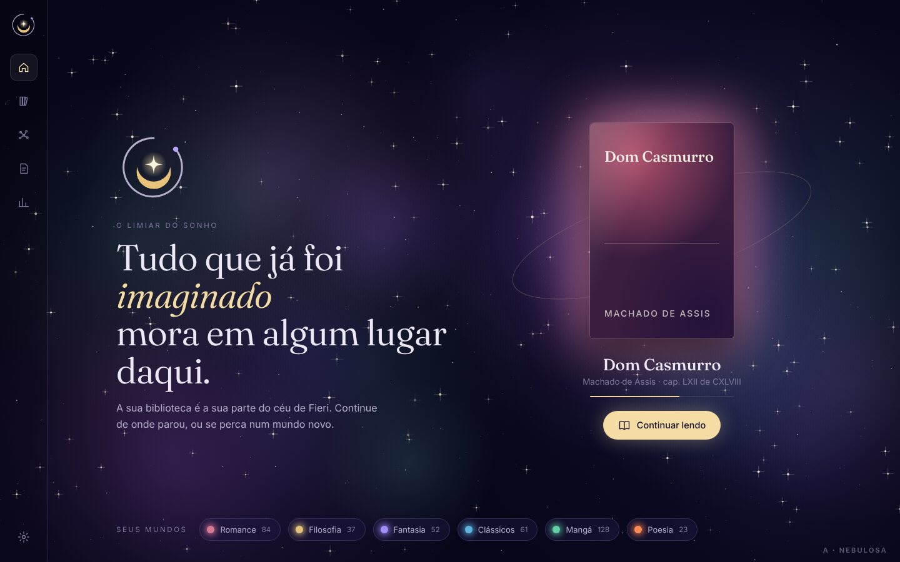
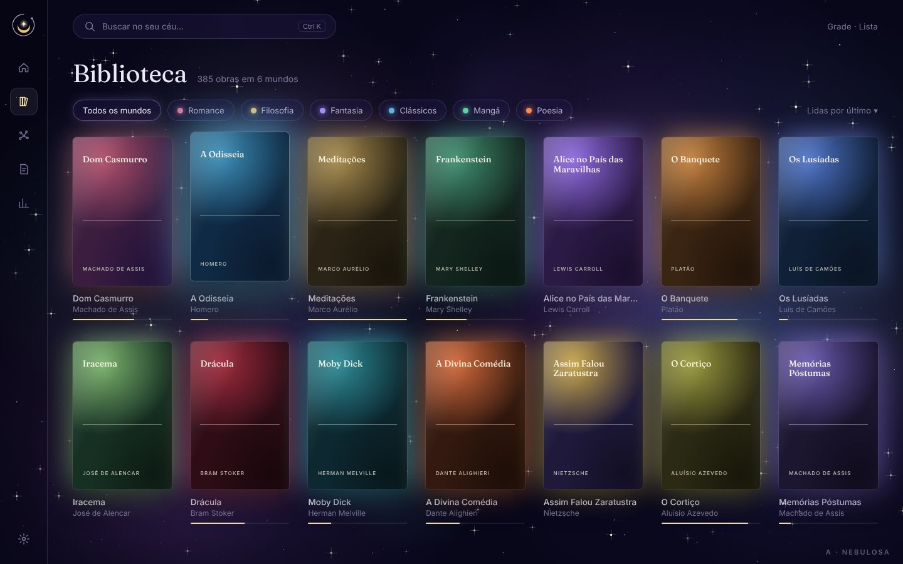
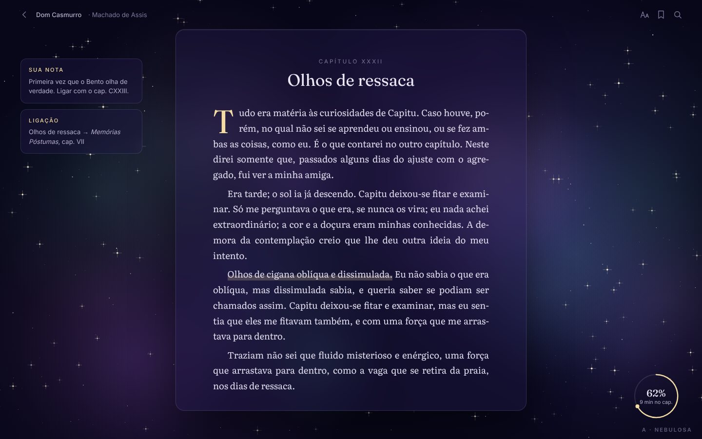
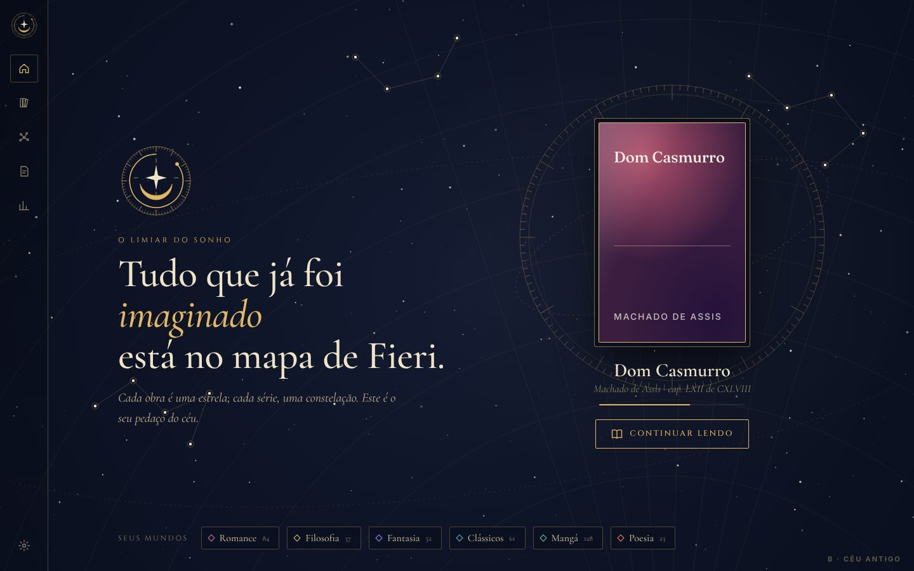
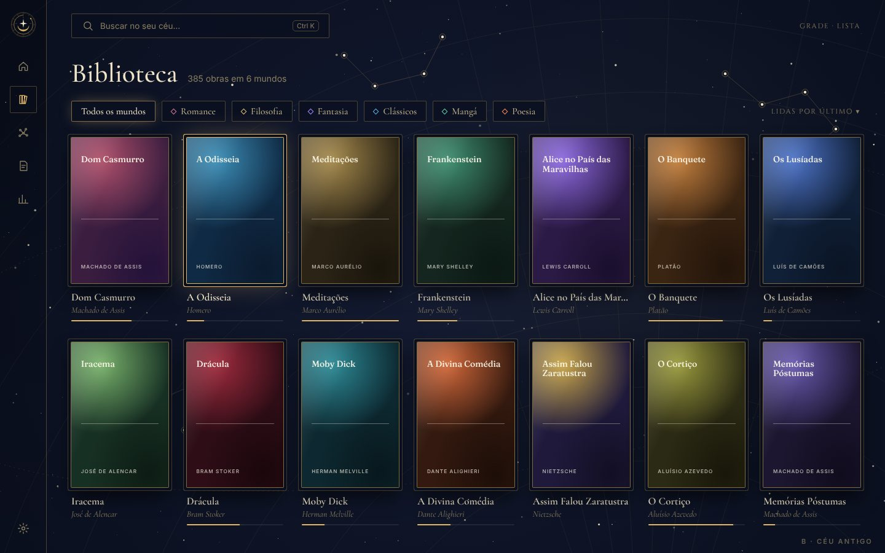
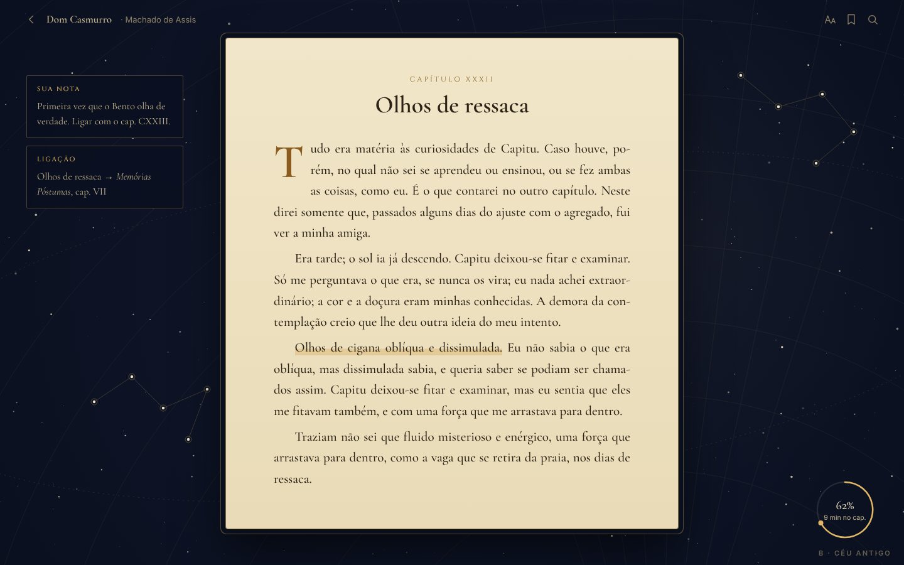
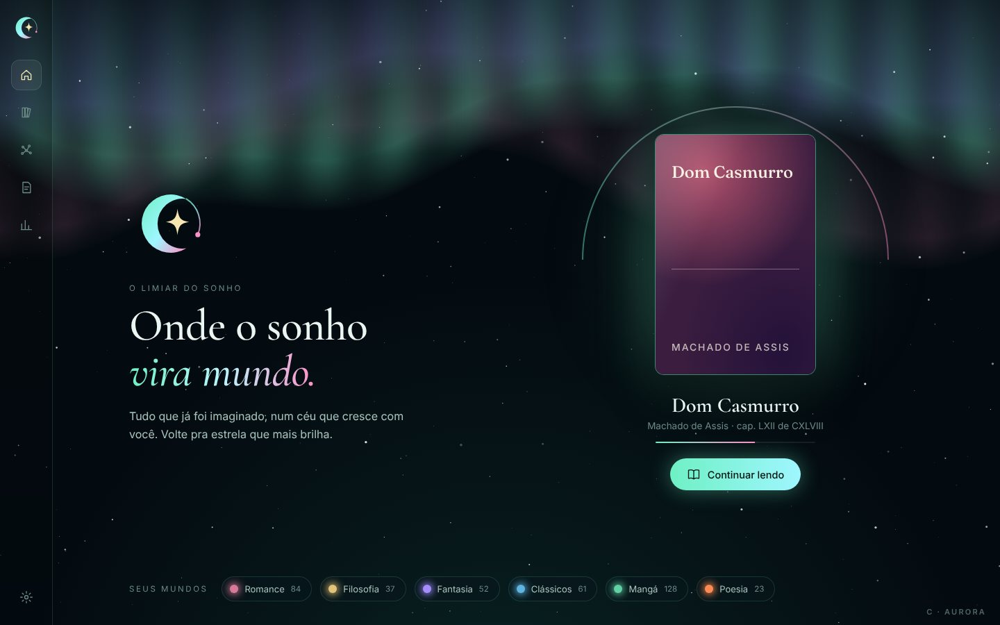
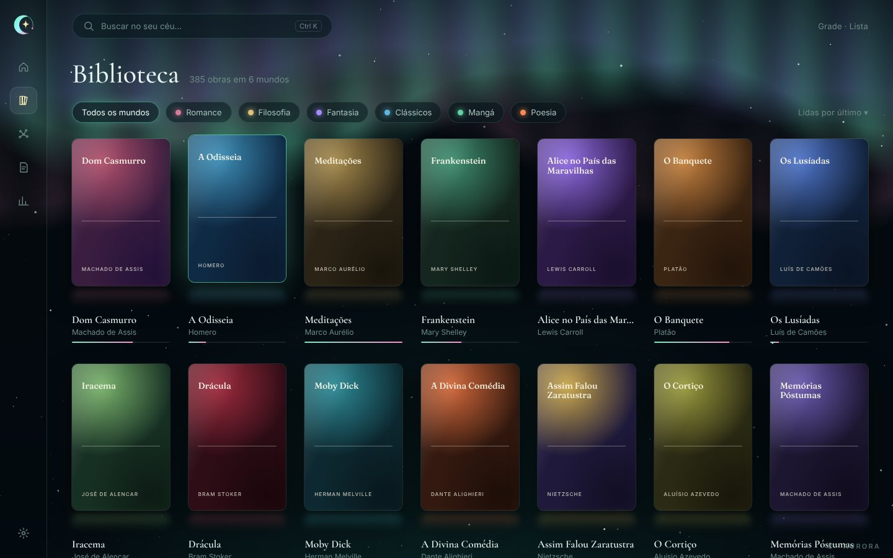
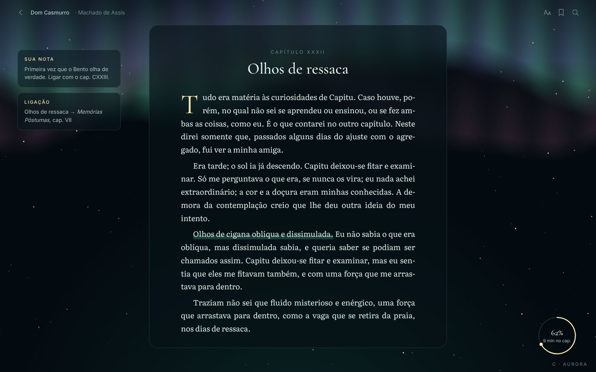

# Identidade de Fieri (2026-11-08)

> **Escolhido (D24): direção B "Céu antigo" com o selo B "Astrolábio".** Os passos de aplicação estão no
> ROADMAP (M1.5). O resto deste documento é a proposta original, mantida como registro.

> Pedido do Marcelo: "não gostei tanto do front". Fieri é a primordial dos sonhos e da imaginação: de onde vem tudo
> que já foi imaginado. A biblioteca dela é a biblioteca de tudo que existe. A pessoa tem que sentir que está
> explorando outros mundos e constelações. O front faz parte da experiência. O modo normal (grade/lista) continua
> por enquanto; a exploração imersiva vem depois.

## O que estava errado no M1

Parece um "app escuro com estrelas": o fundo é chapado, o símbolo (círculos concêntricos) é genérico de astronomia,
as capas são cartões comuns, e nada diz "sonho" nem "mundos". Bonito, mas sem alma de Fieri.

## A ideia: a biblioteca existe dentro do sonho de Fieri

- **O céu de Fieri** é tudo que já foi imaginado. **A sua biblioteca é a sua parte desse céu.**
- **Cada área é um mundo** (Romance, Filosofia, Fantasia, Mangá…): uma nebulosa com cor e clima próprios.
- **Cada obra é uma estrela.** Uma série é uma constelação. Um autor, um aglomerado.
- **Ler é atravessar a estrela:** ela se abre em luz e vira a página.
- **O céu cresce com você:** o que você lê brilha mais; o que terminou deixa um rastro.

## O símbolo: o Selo de Fieri

Três peças, cada uma com um sentido:

```
        ✦            a centelha: a primeira coisa imaginada (estrela de 4 pontas)
     (  ☾  )         a lua crescente embalando a centelha: o sonho
    ◜       ◞        a órbita aberta, com um vão: o "fieri", o vir-a-ser (o sonho nunca termina)
```

- A órbita aberta se desenha sozinha ao abrir o app (o sonho começando).
- Funciona pequeno (ícone 32 px: lua + centelha) e grande (abertura: as três peças, animadas).
- Substitui os círculos concêntricos do M1 (ícone, barra lateral, abertura, selos das capas).

## A linguagem visual nova

| Hoje (M1) | Proposta |
|---|---|
| Fundo escuro chapado com pontinhos | **Nebulosa viva**: névoa colorida em camadas (violeta, índigo, verde-aurora), com profundidade ao mover; um shader leve com reserva em CSS; parado no movimento reduzido |
| Cores: noite + dourado | Noite + **luz de sonho** (dourado quente) + **névoa** (violeta) + **aurora** (verde-água); cada mundo com a sua nebulosa |
| Painéis de vidro comuns | **Véus**: translúcidos com borda que brilha suave, poeira de luz subindo devagar |
| Capas como cartões | **Artefatos de luz**: flutuam, com um halo da cor da capa, e sobem quando o mouse passa |
| Títulos em Fraunces | Testar uma serifa mais mítica (ex.: Cormorant) contra a Fraunces, nos prints |
| Abrir livro: círculo que cresce | A estrela se abre em luz, depois a página aparece |

## Início = o Limiar do Sonho

O selo se desenhando, uma frase, e na frente a obra que você está lendo como a estrela mais forte; atrás, o seu céu
com os mundos. Um clique: continuar lendo.

## O que fica pra depois (como o Marcelo pediu)

A exploração imersiva: voar entre mundos, entrar numa nebulosa, a deriva pelas constelações. Por enquanto, a
grade e a lista continuam sendo o jeito normal de navegar, só que com a linguagem nova.

## Como fazer (marco M1.5, antes de seguir o M3)

1. **Três direções em print** (sem mexer no app): A "Nebulosa", B "Céu antigo" (astrolábio, mapas celestes),
   C "Aurora". Cada uma: Início, Biblioteca e leitor.
2. **Três versões do Selo de Fieri.**
3. O Marcelo escolhe; eu aplico: cores, fundo, selo, Início, capas, transições, mapa como mundos.
4. Checkpoint com prints e o pacote Linux.

## As três direções em print (2026-11-08)

Protótipo estático, fora do app: [ferramentas/identidade/](../ferramentas/identidade/) (`node ferramentas/identidade/prints.mjs`
refaz os prints). Mesmos dados nas três (obras em domínio público), pra comparar só a linguagem.

| | Início (o Limiar do Sonho) | Biblioteca | Leitor |
|---|---|---|---|
| **A · Nebulosa** — névoa violeta/índigo com aurora, capas com halo da própria cor, Fraunces |  |  |  |
| **B · Céu antigo** — mapa celeste gravado em ouro, constelações, astrolábio, molduras finas, Cormorant + Cinzel, página de pergaminho |  |  |  |
| **C · Aurora** — noite verde-escura com cortinas de aurora (verde, violeta, rosa), vidro, reflexo das capas, Cormorant |  |  |  |

**Os três selos** ([selos.jpg](imagens/identidade/selos.jpg)): A · Centelha e lua (a proposta acima), B · Astrolábio,
C · Lua que vira órbita. Cada direção usa o "seu" selo, mas dá pra misturar (ex.: direção A com o selo C).
