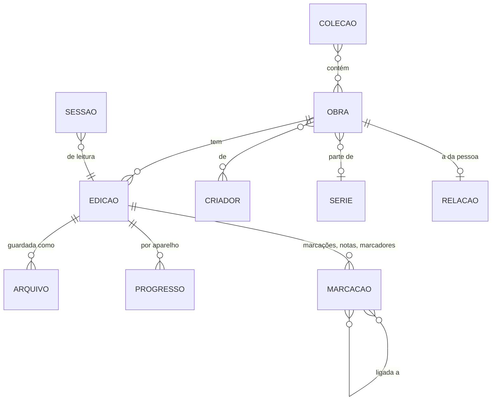

# Modelo de dados do Fierium

> Provisório até o M3 (quando o SQLite e os tipos gerados do Rust chegam). Os tipos TypeScript de hoje estão em
> `packages/contratos/src/index.ts` e seguem este documento.

## 1. Entidades

| Entidade | O que é | Campos principais |
|---|---|---|
| **Obra** | A criação em si (*Dom Casmurro*) | id, titulo, criadores, ano, assuntos, serie?, volume? |
| **Edição** | Uma forma dela: idioma, tradução, formato (EPUB, PDF, áudio) | id, obraId, formato, idioma, editora?, paginas?, capa? |
| **Arquivo** | O arquivo de verdade num aparelho | id, edicaoId, impressao (identidade pelo conteúdo), caminho relativo à pasta, tamanho, aparelho |
| **Coleção** | Um espaço da pessoa, com atmosfera e (depois) regras | id, nome, descricao, atmosfera (matiz), obraIds, regra? |
| **Relação** | Tudo de pessoal sobre a obra | estado (não lida, lendo, lida, deixada), favorita, nota pessoal, adicionadaEm |
| **Progresso** | Onde parou, por edição e por aparelho | posicao (página ou CFI), fracao 0..1, quando |
| **Marcação** | Marca-texto, nota ou marcador ancorado num ponto da edição | id, tipo, ancora, trecho, cor (significado), nota?, ligacoes[] |
| **Sessão** | Um período de leitura | edicaoId, inicio, segundos, paginas, aparelho |

## 2. Identidade

- **Tudo tem UUIDv7** (único, ordenado pelo tempo, gerado no aparelho). Nunca número sequencial, nunca o caminho.
- **Arquivo pela impressão do conteúdo:** hash rápido (começo + fim + tamanho) e, se precisar desempatar, o hash do
  arquivo inteiro em segundo plano. Renomear ou mover não perde nada; o mesmo livro em dois aparelhos é reconhecido.
- A obra é reconhecida pelos metadados (título + criador normalizados); a pessoa pode juntar ou separar.

## 3. Marcação dinâmica

| Campo | Significado |
|---|---|
| `tipo` | `destaque` (marca-texto), `nota` (nota solta num ponto), `marcador` (só lembrar o lugar) |
| `cor` | um id de **cor com significado** definido pela pessoa (`importante`, `duvida`, `citacao`, `ideia`…) |
| `ancora` | onde está: EPUB = CFI do começo e do fim; PDF = página + retângulos normalizados (0..1); sempre com o **trecho citado** (o texto e um pedaço antes e depois), que conserta a âncora se o layout mudar |
| `nota` | texto livre (Markdown simples) |
| `ligacoes` | ids de outras marcações (até de outros livros) ou de obras |
| `etiquetas` | etiquetas livres |

O formato segue a ideia da W3C Web Annotation (alvo + seletores), pra exportar e importar sem perder.

## 4. Estatísticas

Vêm das **sessões**. O diário (por dia e por aparelho) é calculado a partir delas: cada aparelho só escreve a sua
parte e juntar é somar partes diferentes, nunca contar duas vezes (a ideia que funcionou no KOFlibrary). Metas são
da pessoa: período (dia, semana, mês, ano), o quê (livros, páginas, minutos) e quanto.

## 5. Pronto pra sincronizar (D8)

| Regra | Como |
|---|---|
| Cada mudança tem quem e quando | relógio lógico híbrido (HLC) + id do aparelho, por campo |
| Apagar | lápide (`apagadoEm`), limpa depois de um tempo |
| Juntar | progresso: o mais adiantado e mais novo; contadores: por aparelho, somados; conjuntos (etiquetas, coleções, marcações): união menos lápides; campos de texto curtos: o mais novo vence; nota com conflito de verdade: guarda as duas e avisa |
| Enviar só o que mudou | registro de mudanças local (cada escrita gera uma linha) |

## 6. Versões e migração

O banco e o formato de exportação têm número de versão. Cada mudança de esquema é uma migração numerada, testada
com um banco da versão anterior. O formato de exportação é documentado e aberto.
