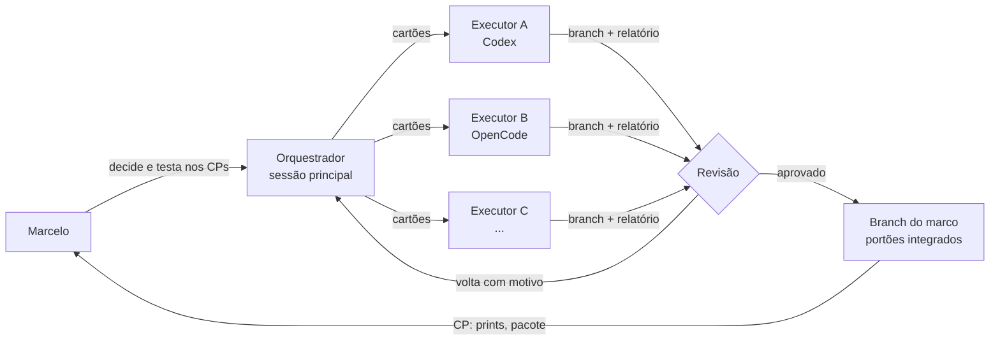
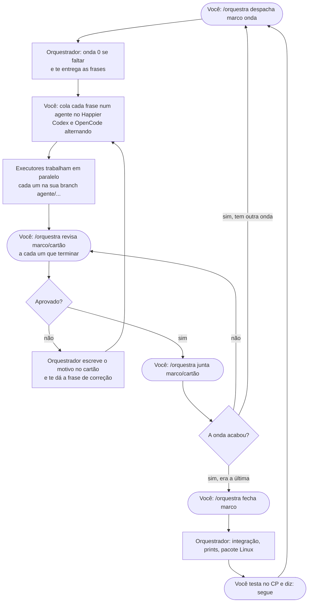

# Orquestração: vários agentes, um orquestrador

> Pedido do Marcelo (2026-11-08): "um plano pra vários agentes; você vai ser mais orquestrador que executor". Decisão
> D27. Vale a partir do resto do M1.5.

## A ideia em uma frase

A sessão principal **não escreve a maior parte do código**: ela fatia cada marco em **cartões** pequenos e
independentes, entrega cada cartão a um agente executor (Codex, OpenCode, o que vier), **revisa** o que
volta, junta, roda os portões integrados e leva o resultado pro Marcelo no checkpoint.



## Papéis

| Papel | Quem | Faz | Não faz |
|---|---|---|---|
| **Dono** | Marcelo | Decide produto e identidade, testa nos checkpoints, aprova ondas ("segue") | — |
| **Orquestrador** | A sessão principal (Claude) | Fatia o marco, escreve os cartões, decide a ordem (ondas), despacha, revisa, junta, roda os portões integrados, mantém JORNAL/ROADMAP/DECISOES, fala com o Marcelo | Não pega cartão de executor, exceto o que é **integração** ou **decisão de produto** (marcados 🧭) |
| **Executor** | Codex e OpenCode (o Claude não executa: limite de uso) | Executa **um** cartão numa branch própria, roda os portões, escreve o relatório | Não mexe fora dos arquivos do cartão, não muda contrato nem decisão, não junta na branch do marco |
| **Revisor** | O orquestrador (Claude) no fim de cada cartão; se quiser uma segunda opinião, o Codex revisa o do OpenCode e vice-versa | Confere o diff contra o cartão: só os arquivos permitidos, o "pronto quando", os testes novos, o print | Não reescreve; aponta e devolve |

## O cartão

Cada passo despachado vira um arquivo em `docs/cartoes/<marco>/<passo>.md`, pelo [modelo](cartoes/MODELO.md). O
cartão é **tudo** que o executor precisa: ele lê o AGENTS.md, o cartão e os arquivos que o cartão manda ler, e mais
nada. Um cartão bom:

- cabe numa sessão (meio dia de trabalho de uma pessoa, no máximo);
- diz **os arquivos que pode mexer** (e os que não pode);
- tem **"pronto quando"** que dá pra conferir sem conversa (comando, teste, print);
- diz **do que depende** (outros cartões) e **o que destrava**.

Como mandar um cartão pra um agente (a mesma frase serve pra qualquer um):

> Execute o cartão `docs/cartoes/m1.5/i3.md` do repositório Fierium, a partir da branch `<branch do marco>`. Siga o
> AGENTS.md. No fim, escreva o relatório no próprio cartão e envie a branch.

O Marcelo dispara os executores (Codex e OpenCode), um por um com a frase acima ou a onda toda com `pnpm despachar`;
o orquestrador não abre sessões de executor (D28).

## Raias: quem mexe onde

Paralelo só funciona se dois executores não mexem no mesmo arquivo. As raias:

| Raia | Pastas | Observação |
|---|---|---|
| **Design system** | `packages/ui/` | `tokens.css` é do orquestrador (mexe muito em tudo) |
| **Casca** | `apps/app/src/casca/` | |
| **Telas** | `apps/app/src/recursos/<x>/` (uma raia por funcionalidade) | Funcionalidade não importa outra (o lint confere) |
| **Peças comuns** | `apps/app/src/compartilhado/` | Um cartão por vez |
| **Leitores** | `packages/leitores/` | Um motor por cartão |
| **Núcleo Rust** | `crates/fierium-core/` (um módulo por cartão), `crates/fierium-app/` | |
| **Ferramentas e pacote** | `ferramentas/`, `.github/`, ícones | |
| **Só o orquestrador** | `packages/contratos/`, `docs/CONTRATOS.md`, `tokens.css`, `pnpm-lock.yaml`/`Cargo.lock` (dependência nova), `docs/` (fora o relatório no cartão), `AGENTS.md` | É o que todos usam: muda numa onda própria, antes |

**Contrato primeiro:** quando um marco precisa de front e Rust ao mesmo tempo (M3 em diante), a onda 0 é do
orquestrador: o contrato (`packages/contratos` + `CONTRATOS.md`) e o adaptador de exemplo. Com o contrato fixo, o
front e o Rust andam em paralelo sem se esperar.

**Dependência nova:** o cartão pede ("precisa de `blake3 1.8`"); o orquestrador instala antes de despachar, pra o
lockfile não brigar.

## O ciclo de um marco

1. **Fatiar** (🧭): o orquestrador lê o marco no ROADMAP e escreve os cartões, com o grafo de dependências e as ondas.
2. **Onda 0** (🧭): contratos, dependências, esqueleto (pastas, rotas vazias) na branch do marco `marco/<mN>`.
3. **Despachar** a onda: um cartão por executor, cada um em `agente/<marco>-<passo>`, saindo da branch do marco.
4. **Executar**: o executor faz, roda `pnpm check` (+ `pnpm e2e` se mexeu em tela, `pnpm check:rust` se mexeu no
   Rust) e preenche o relatório do cartão.
5. **Revisar**: diff confinado às pastas do cartão? "pronto quando" atendido? testes novos? print bate? Se não, volta
   com o motivo escrito no cartão.
6. **Juntar** na branch do marco (merge, sem reescrever a branch do executor), rodar os portões integrados.
7. Próxima onda. No fim: **integração** (🧭), prints, pacote Linux, JORNAL, e o **checkpoint** com o Marcelo.

## Economia (o Marcelo liga pra tokens)

- O orquestrador lê o **relatório**, o `git diff --stat` e os prints; abre o código só onde o relatório ou a revisão
  apontam problema.
- O cartão manda o executor ler **só** o que precisa (nada de "leia o projeto todo").
- Revisão cruzada entre modelos diferentes pega o que o mesmo modelo deixaria passar, sem o orquestrador reler tudo.

## Ondas planejadas

| Marco | Mapa das ondas | Cartões |
|---|---|---|
| M1.5 (resto) | [m1.5/ONDAS.md](cartoes/m1.5/ONDAS.md) | I.3, I.4, I.6, I.7 (onda 1) → I.8 (onda 2) → I.9 🧭 |
| M3 | [m3/ONDAS.md](cartoes/m3/ONDAS.md) | 13 cartões em 4 ondas, depois da onda 0 🧭 (crates, dependências, contrato) |
| M4 | [m4/ONDAS.md](cartoes/m4/ONDAS.md) | 8 cartões; o motor de PDF sozinho na onda 1 |
| M7 em diante | — | Fatiados quando o M4 fechar (o que se aprende no M3 e no M4 muda o tamanho certo dos cartões) |

## Como o Marcelo toca (no Happier)

Você roda os executores (Codex e OpenCode) no Happier ou com `pnpm despachar`; a sessão do orquestrador é onde você fala comigo. Os comandos
são todos pro orquestrador; pro executor é sempre a mesma frase, que o orquestrador te entrega pronta.

| Você quer | Diga pro orquestrador | O que eu faço |
|---|---|---|
| Ver como está | `/orquestra painel` | Busco as branches, rodo `pnpm cartoes`, digo o que está pronto, parado e o próximo passo |
| Começar uma onda | `/orquestra despacha m3 1` | Faço a onda 0 se faltar, marco os cartões e te dou a frase de cada um, dizendo qual vai pro Codex e qual pro OpenCode |
| Um executor terminou | `/orquestra revisa m1.5/i4` | Confiro o cartão contra a branch; aprovo ou devolvo com o motivo e a frase de correção |
| Juntar o aprovado | `/orquestra junta m1.5/i4` | Merge na branch do marco, portões integrados, envio |
| Fechar o marco | `/orquestra fecha m1.5` | Integração, prints, pacote Linux, JORNAL; paro no checkpoint pra você testar |

(Sem o `/orquestra`, funciona falar normal: "revisa o i4", "despacha a onda 1 do m3".)

**Despachar a onda inteira com um comando** (no terminal do teu Linux, na pasta do Fierium):

```bash
pnpm despachar m1.5 1
```

Cada cartão da onda ganha uma pasta separada (`../fierium-agentes/<marco>-<cartão>`, um git worktree na branch do
cartão, com `pnpm install` feito) e uma sessão própria de agente numa janela do tmux, todas em paralelo, alternando
**Codex e OpenCode** (o Claude é o orquestrador: não executa, revisa no fim). Quando o agente termina, o script faz o commit do que sobrou (se sobrou) e envia a branch. Acompanhar:
`tmux attach -t fierium-m1_5-1` (Ctrl+B, N passa de janela) ou os logs em `../fierium-agentes/logs/`. Opções:
`--so-codex`, `--so-opencode`, `--modelo-opencode=<provedor/modelo>`, `--simular` (só mostra quem faria o quê). Precisa: `tmux`, `codex` e `opencode` instalados
e logados, e o git do Linux com permissão de enviar pro GitHub. Ondas 🧭 o script recusa (são do orquestrador).

Ou um por um, colando no Happier (Codex ou OpenCode):

> Execute o cartão `docs/cartoes/<marco>/<cartão>.md` do repositório Fierium, a partir da branch `<base>`. Siga o
> AGENTS.md. No fim, escreva o relatório no próprio cartão e envie a branch.



**Revisão (D28):** eu (Claude) reviso no fim, lendo o relatório, o `diff --stat` e os prints, pra gastar pouco. Se
quiser uma segunda opinião antes, peça ao Codex pra revisar o que o OpenCode fez (e vice-versa) com a frase
"revise a branch X contra o cartão Y e escreva o que achou no relatório".
