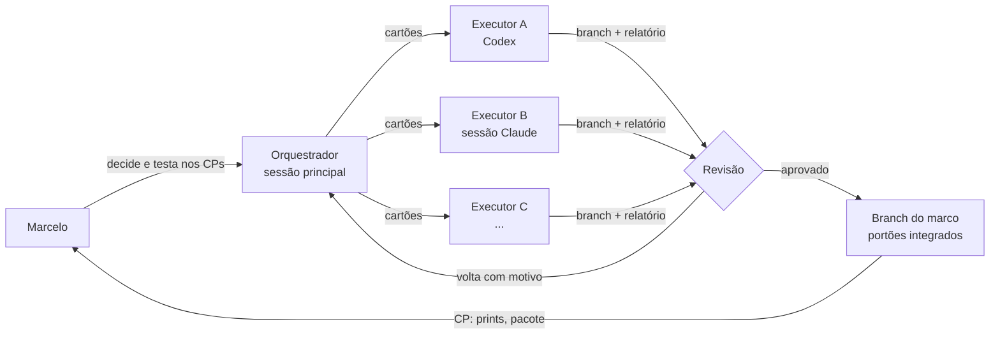

# Orquestração: vários agentes, um orquestrador

> Pedido do Marcelo (2026-11-08): "um plano pra vários agentes; você vai ser mais orquestrador que executor". Decisão
> D27. Vale a partir do resto do M1.5.

## A ideia em uma frase

A sessão principal **não escreve a maior parte do código**: ela fatia cada marco em **cartões** pequenos e
independentes, entrega cada cartão a um agente executor (Codex, outra sessão do Claude, o que vier), **revisa** o que
volta, junta, roda os portões integrados e leva o resultado pro Marcelo no checkpoint.

## Papéis

| Papel | Quem | Faz | Não faz |
|---|---|---|---|
| **Dono** | Marcelo | Decide produto e identidade, testa nos checkpoints, aprova ondas ("segue") | — |
| **Orquestrador** | A sessão principal (Claude) | Fatia o marco, escreve os cartões, decide a ordem (ondas), despacha, revisa, junta, roda os portões integrados, mantém JORNAL/ROADMAP/DECISOES, fala com o Marcelo | Não pega cartão de executor, exceto o que é **integração** ou **decisão de produto** (marcados 🧭) |
| **Executor** | Codex, sessões do Claude, outros | Executa **um** cartão numa branch própria, roda os portões, escreve o relatório | Não mexe fora dos arquivos do cartão, não muda contrato nem decisão, não junta na branch do marco |
| **Revisor** | Um modelo **diferente** de quem executou (Codex revisa Claude e vice-versa), ou o orquestrador | Confere o diff contra o cartão: só os arquivos permitidos, o "pronto quando", os testes novos, o print | Não reescreve; aponta e devolve |

## O cartão

Cada passo despachado vira um arquivo em `docs/cartoes/<marco>/<passo>.md`, pelo [modelo](cartoes/MODELO.md). O
cartão é **tudo** que o executor precisa: ele lê o AGENTS.md, o cartão e os arquivos que o cartão manda ler, e mais
nada. Um cartão bom:

- cabe numa sessão (meio dia de trabalho de uma pessoa, no máximo);
- diz **os arquivos que pode mexer** (e os que não pode);
- tem **"pronto quando"** que dá pra conferir sem conversa (comando, teste, print);
- diz **do que depende** (outros cartões) e **o que destrava**.

Como mandar um cartão pra um agente (a mesma frase serve pra qualquer um):

> Execute o cartão `docs/cartoes/m1.5/i3.md` do repositório Fierium, a partir da branch `<branch do marco>`. Siga o
> AGENTS.md. No fim, escreva o relatório no próprio cartão e envie a branch.

O orquestrador também pode abrir sessões do Claude sozinho (uma por cartão) e acompanhar por elas; o Codex o Marcelo
dispara com a frase acima (ou o orquestrador, se tiver acesso).

## Raias: quem mexe onde

Paralelo só funciona se dois executores não mexem no mesmo arquivo. As raias:

| Raia | Pastas | Observação |
|---|---|---|
| **Design system** | `packages/ui/` | `tokens.css` é do orquestrador (mexe muito em tudo) |
| **Casca** | `apps/app/src/casca/` | |
| **Telas** | `apps/app/src/recursos/<x>/` (uma raia por funcionalidade) | Funcionalidade não importa outra (o lint confere) |
| **Peças comuns** | `apps/app/src/compartilhado/` | Um cartão por vez |
| **Leitores** | `packages/leitores/` | Um motor por cartão |
| **Núcleo Rust** | `crates/fierium-core/` (um módulo por cartão), `crates/fierium-app/` | |
| **Ferramentas e pacote** | `ferramentas/`, `.github/`, ícones | |
| **Só o orquestrador** | `packages/contratos/`, `docs/CONTRATOS.md`, `tokens.css`, `pnpm-lock.yaml`/`Cargo.lock` (dependência nova), `docs/` (fora o relatório no cartão), `AGENTS.md` | É o que todos usam: muda numa onda própria, antes |

**Contrato primeiro:** quando um marco precisa de front e Rust ao mesmo tempo (M3 em diante), a onda 0 é do
orquestrador: o contrato (`packages/contratos` + `CONTRATOS.md`) e o adaptador de exemplo. Com o contrato fixo, o
front e o Rust andam em paralelo sem se esperar.

**Dependência nova:** o cartão pede ("precisa de `blake3 1.8`"); o orquestrador instala antes de despachar, pra o
lockfile não brigar.

## O ciclo de um marco

1. **Fatiar** (🧭): o orquestrador lê o marco no ROADMAP e escreve os cartões, com o grafo de dependências e as ondas.
2. **Onda 0** (🧭): contratos, dependências, esqueleto (pastas, rotas vazias) na branch do marco `marco/<mN>`.
3. **Despachar** a onda: um cartão por executor, cada um em `agente/<marco>-<passo>`, saindo da branch do marco.
4. **Executar**: o executor faz, roda `pnpm check` (+ `pnpm e2e` se mexeu em tela, `pnpm check:rust` se mexeu no
   Rust) e preenche o relatório do cartão.
5. **Revisar**: diff confinado às pastas do cartão? "pronto quando" atendido? testes novos? print bate? Se não, volta
   com o motivo escrito no cartão.
6. **Juntar** na branch do marco (merge, sem reescrever a branch do executor), rodar os portões integrados.
7. Próxima onda. No fim: **integração** (🧭), prints, pacote Linux, JORNAL, e o **checkpoint** com o Marcelo.

## Economia (o Marcelo liga pra tokens)

- O orquestrador lê o **relatório**, o `git diff --stat` e os prints; abre o código só onde o relatório ou a revisão
  apontam problema.
- O cartão manda o executor ler **só** o que precisa (nada de "leia o projeto todo").
- Revisão cruzada entre modelos diferentes pega o que o mesmo modelo deixaria passar, sem o orquestrador reler tudo.

## Ondas planejadas

### M1.5 (resto)

| Onda | Cartões | Raia | Quem |
|---|---|---|---|
| 1 | [I.3 ícones do selo](cartoes/m1.5/i3.md) · [I.4 fundo de mapa celeste](cartoes/m1.5/i4.md) | ferramentas+ui · casca | executores, em paralelo |
| 1 | [I.6 capas e mundos](cartoes/m1.5/i6.md) · [I.7 leitor em pergaminho](cartoes/m1.5/i7.md) | compartilhado+biblioteca · leitor | executores, em paralelo |
| 2 | I.8 transição de abrir obra (🧭: mexe na casca e no leitor juntos) | casca+leitor | orquestrador ou um executor depois da onda 1 |
| 3 | I.9 integração: prints, README, pacote Linux, CP1.5 (🧭) | — | orquestrador |

As quatro da onda 1 não se tocam: dá pra disparar as quatro de uma vez.

### M3 (núcleo Rust e biblioteca de verdade) — esboço; os cartões saem quando o M1.5 fechar

| Onda | Cartões | Raia |
|---|---|---|
| 0 🧭 | Contrato da biblioteca (comandos `biblioteca.*`, `pastas.*`, `busca.*`) + dependências (rusqlite, uuid, blake3, walkdir, zip, quick-xml, tauri-plugin-dialog) + esqueleto dos módulos | orquestrador |
| 1 | Banco: SQLite + migrações numeradas e testadas · modelo obra → edição → arquivo, UUIDv7, registro de mudanças | `core/banco` |
| 1 | Varredura: pastas, novo/movido/apagado, identidade pelo conteúdo (blake3) | `core/varredura` |
| 1 | Metadados: PDF · EPUB · CBZ/CBR · pelo nome do arquivo (4 cartões, um por formato) | `core/metadados/<formato>` |
| 1 | Gerador de pastas de teste (2.000 arquivos sintéticos, sem livro de verdade) | `ferramentas/` |
| 2 | Reconhecer obra e série, juntar e separar · busca FTS5 sem acento · coleções no banco | `core/obras`, `core/busca`, `core/colecoes` |
| 2 | Comandos no `fierium-app` ligando tudo (porta `chamar`) | `fierium-app` |
| 3 | Front: adaptador combinado passando a biblioteca pro Rust · tela de escolher pastas | `apps/app` |
| 3 | Teste de contrato exemplo × Rust · orçamento com 2.000 arquivos | testes |
| 4 🧭 | Integração, prints, pacote, CP3 | orquestrador |

Os marcos seguintes (M4, M7, M8…) são fatiados do mesmo jeito quando chegarem: o leitor de PDF, por exemplo, quebra
bem em "motor pdf.js aos pedaços", "zoom e página dupla", "sumário e busca", "cortar margens", "Pintor", "posição
exata", "escaneados".
