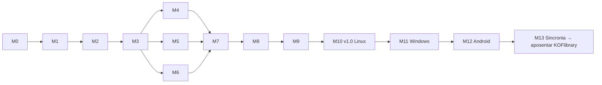

# Roadmap do Fierium

> Checklist dos marcos. Como cada marco é tocado (branch, portões de qualidade, definição de pronto, checkpoint):
> [PLANO.md](PLANO.md).
>
> **Cada marco termina num checkpoint (CP):** eu paro, entrego (comando, roteiro do que conferir, prints, testes) e
> você testa. Só sigo depois do teu "segue".
>
> Estado: ⬜ não começou · 🟨 em andamento · ⏸ esperando você testar · ✅ aprovado

## Visão geral

| Marco | Entrega | Versão | Tamanho | Estado |
|---|---|---|---|---|
| M0 | Fundação e plano | — | P | 🟨 |
| M1 | Protótipo de interface (navegador, biblioteca de exemplo) | v0.1 | G | 🟨 |
| M2 | Prova técnica: Tauri no Linux (e um APK de teste) | v0.2 | M | ⬜ |
| M3 | Núcleo Rust e biblioteca de verdade | v0.3 | G | ⬜ |
| M4 | Leitor de PDF | v0.4 | G | ⬜ |
| M5 | Leitor de EPUB | v0.5 | M | ⬜ |
| M6 | Leitor de mangá e HQ (CBZ, CBR) | v0.6 | M | ⬜ |
| M7 | Marcações, notas e ligações | v0.7 | G | ⬜ |
| M8 | Estatísticas e metas | v0.8 | M | ⬜ |
| M9 | Backup, exportar/importar e importar o KOFlibrary | v0.9 | M | ⬜ |
| M10 | **Lançamento Linux** (pacote + atualização assinada) | **v1.0** | M | ⬜ |
| M11 | Windows | v1.1 | M | ⬜ |
| M12 | Android | v1.2 | G | ⬜ |
| M13 | Sincronia PC ↔ celular → **aposentar o KOFlibrary** | v1.3 | G | ⬜ |

Tamanho: P (uma sessão), M (duas ou três), G (várias).

---

## M0 — Fundação e plano 🟨

**Objetivo:** projeto organizado antes de qualquer tela.

- [x] Monorepo pnpm (`apps/`, `packages/`, `docs/`), TypeScript estrito, ESLint com regra de camadas, Prettier
- [x] `pnpm check` (formato, lint, tipos, testes)
- [x] CI do GitHub (Linux e Windows)
- [x] `.gitignore` barrando livros e chaves
- [x] Visão de produto, arquitetura, modelo de dados, decisões, plano de engenharia, este roadmap
- [ ] `README.md`, `AGENTS.md`/`CLAUDE.md`, `docs/CONTRATOS.md`, `docs/JORNAL.md`
- [ ] Repositório `Fierium` criado por você (vazio) e o primeiro push com o CI verde

**Aceite (CP0):** você aprova o PLANO e este ROADMAP; o CI roda verde no GitHub.

## M1 — Protótipo de interface 🟨

**Objetivo:** o app inteiro de cara, no navegador, com uma biblioteca de exemplo (40 obras de domínio público e duas
séries de mangá inventadas), pra aprovar o visual e a navegação **antes** de ligar o Rust.
**Fora do escopo:** teus arquivos de verdade (M3), PDF/EPUB/mangá de verdade (M4–M6).

Base
- [x] Contrato provisório: tipos e 20 comandos
- [x] Adaptador de exemplo em memória, imitando o Rust, guardando as mudanças entre recarregamentos
- [x] Testes da base (busca sem acento, marcações, estatísticas, guardar): 11 passando

Design system
- [x] Temas Noite e Claro; fontes embutidas (Fraunces, Inter, Literata); ícones; capas geradas; anel de progresso

Casca
- [x] Barra lateral (computador) e barra de baixo (celular)
- [x] Fundo com céu animado (para no movimento reduzido e com o leitor aberto)
- [x] Buscar (Ctrl+K): obras, autores, coleções, frases marcadas e comandos
- [x] Avisos de erro (código + mensagem em português)
- [ ] Nomes simples na interface (D15): Início, Biblioteca, Coleções, Notas, Estatísticas, Ajustes, Buscar
- [ ] Juntar a casca e o estilo das telas

Telas
- [ ] Primeira abertura (escolher "biblioteca de exemplo"; "escolher pasta" chega no M3)
- [ ] **Início**: continuar lendo, em andamento, uma marcação antiga que volta, nunca abertos, adicionados recentemente
- [ ] **Biblioteca — grade/lista**: busca, filtros (estado, área, formato, favoritas), ordenar
- [ ] **Biblioteca — mapa**: as obras como luzes agrupadas por área, brilho pelo progresso, arrastar e zoom
- [ ] **Coleções**: lista, página da coleção com a cor dela, criar coleção
- [ ] **Página da obra**: capa, dados, edições e arquivos, progresso, marcações, coleções, obras parecidas
- [ ] **Leitor de demonstração** (Dom Casmurro de verdade): abertura animada, interface que some, temas (papel, sépia, noite, tinta), fonte, tamanho, entrelinha, largura
- [ ] **Marcação no leitor**: selecionar → cor com significado → nota; mudar cor, apagar; painel das marcações do livro
- [ ] **Notas**: todas as marcações, filtro por cor, busca, ligações, exportar Markdown
- [ ] **Estatísticas**: hoje, semana, sequência, recorde, calendário do ano, últimos 30 dias, por área, metas
- [ ] **Ajustes**: tema, movimento reduzido, padrões de leitura, cores das marcações, recomeçar o exemplo

Fechamento
- [ ] Testes de fluxo (Playwright) com prints de computador e celular
- [ ] Prévia publicada pra você abrir sem instalar nada

**Aceite (CP1):** com `pnpm install && pnpm dev` (ou a prévia): achar um livro pela grade, pelo mapa e pela busca;
abrir a leitura e voltar pro mesmo lugar; marcar com duas cores, anotar, ver nas Notas e exportar; ver as
Estatísticas e criar uma meta; trocar pro tema Claro; tudo usável numa janela estreita (celular); recarregar e as
mudanças continuarem.

## M2 — Prova técnica: Tauri no Linux ⬜

**Objetivo:** confirmar a stack no teu Linux antes de construir o núcleo (risco R1 do PLANO).

- [ ] Tauri 2 com o front do M1, abrindo como programa no Linux
- [ ] Comando `app.info` no Rust, com os tipos gerados pro TypeScript
- [ ] Adaptador Tauri na porta `Cliente` (as telas não mudam)
- [ ] Protocolo de arquivo **aos pedaços** (Range)
- [ ] Medição no Linux: PDF de 500 MB (abrir, rolar, memória), animações do fundo
- [ ] APK Android de teste com a mesma medição
- [ ] CI: `cargo fmt`, `clippy`, `cargo test`

**Aceite (CP2):** você abre o executável no teu Linux; os números batem com os orçamentos do PLANO §5.3 (ou o plano
B do R1 é acionado). Decisão registrada: manter o Tauri.

## M3 — Núcleo Rust e biblioteca de verdade ⬜

**Objetivo:** a tua pasta de livros de verdade dentro do Fierium.

- [ ] SQLite com migrações numeradas e testadas
- [ ] Modelo obra → edição → arquivo; UUIDv7; registro de mudanças e relógio lógico (pronto pra sincronia)
- [ ] Escolher pastas; varrer; perceber arquivo novo, movido e apagado
- [ ] Identidade do arquivo pelo conteúdo
- [ ] Capa, título, autor, ano e série de PDF, EPUB e CBZ/CBR (e pelo nome do arquivo)
- [ ] Reconhecer obra e série; juntar e separar à mão
- [ ] Busca (FTS5): títulos, autores, assuntos, notas
- [ ] Coleções no banco
- [ ] Front ligado ao Rust (o exemplo continua pro `pnpm dev` e os testes)
- [ ] Teste de contrato (exemplo × Rust) e teste com 2.000 arquivos gerados

**Aceite (CP3):** tua pasta aparece com capas e títulos certos; renomear e mover um arquivo não perde nada; a busca
acha por autor sem acento; abrir com 2.000 arquivos cumpre o orçamento.

## M4 — Leitor de PDF ⬜

- [ ] pdf.js recebendo aos pedaços; desenha só as páginas perto da tela
- [ ] Zoom (largura, página inteira, livre), página dupla
- [ ] Sumário e busca no livro
- [ ] Cortar margens
- [ ] Temas que repintam a página (o Pintor do KOFlibrary, reescrito), brilho, contraste, luz quente
- [ ] Posição exata salva
- [ ] PDF escaneado (JPEG 2000, JBIG2)

**Aceite (CP4):** teus PDFs grandes e escaneados abrem no orçamento; tema noite repinta sem estragar figuras; fechar
e abrir volta na mesma página.

## M5 — Leitor de EPUB ⬜

- [ ] foliate-js (versão fixa, vendorizada) lendo pelo Rust
- [ ] Fonte, tamanho, entrelinha, margens, justificar; página ou rolagem; colunas na tela larga
- [ ] Temas de leitura; sumário; busca no livro
- [ ] Posição exata (CFI)

**Aceite (CP5):** teus EPUBs abrem com capa, sumário e as tuas preferências; mudar a fonte não perde a posição.

## M6 — Leitor de mangá e HQ ⬜

- [ ] CBZ lido aos pedaços; CBR (biblioteca com licença compatível — R3)
- [ ] Direita → esquerda (padrão), esquerda → direita, vertical
- [ ] Página dupla na tela larga; capa e página larga sozinhas
- [ ] Séries em ordem (volume/capítulo), "próximo capítulo" no fim
- [ ] Cortar bordas brancas; temas
- [ ] Pré-carregar as próximas páginas sem estourar a memória

**Aceite (CP6):** uma série tua em CBZ e CBR na ordem certa; virar página < 100 ms; chegar no fim abre o próximo.

## M7 — Marcações, notas e ligações ⬜

- [ ] Marca-texto no PDF e no EPUB (âncora que resiste a fonte e zoom); marcação de região no mangá
- [ ] Cores com significado que você define
- [ ] Nota na marcação; ajustar as pontas arrastando
- [ ] Marcador de página e nota solta
- [ ] Ligar uma marcação a outra (até de outro livro)
- [ ] Tela de Notas com os dados reais: busca, filtros, ir pro trecho
- [ ] Exportar Markdown

**Aceite (CP7):** marcar e anotar num PDF e num EPUB; mudar a fonte do EPUB e a marcação continuar no lugar;
ligar com outro livro; exportar e abrir o Markdown.

## M8 — Estatísticas e metas ⬜

- [ ] Sessões reais (só conta lendo de verdade)
- [ ] Diário por dia e por aparelho (sem contar duas vezes)
- [ ] Sequência (hoje sem leitura não quebra), recorde
- [ ] Metas que você escolhe (período, o quê, quanto), várias
- [ ] Calendário do ano, últimos 30 dias, por área, horário favorito, tempo restante pelo teu ritmo
- [ ] Retrospectiva do mês/ano

**Aceite (CP8):** uma semana de uso real batendo com o que você leu.

## M9 — Backup, exportar/importar e importar o KOFlibrary ⬜

- [ ] Backup automático dos dados pessoais (guarda os últimos N)
- [ ] Exportar e importar tudo (formato aberto e versionado, que junta sem estragar; importar duas vezes não duplica)
- [ ] Importar o `.koflib`: progresso, notas, marcadores, estatísticas
- [ ] Teste com backups do KOFlibrary gerados pelos testes

**Aceite (CP9):** o teu backup do KOFlibrary entra e você continua de onde parou nos teus livros.

## M10 — Lançamento Linux (v1.0) ⬜

- [ ] AppImage (e avaliar Flatpak)
- [ ] Atualização automática assinada; chave só no segredo do CI
- [ ] Lançar = tag + CI (nunca push na main)
- [ ] Ícone, entrada no menu, nome e versão no "Sobre"
- [ ] Revisão de acessibilidade (teclado, contraste, movimento reduzido) e de desempenho (PLANO §5.3)

**Aceite (CP10):** instalar pelo pacote, usar uma semana, receber uma atualização sozinho.

## M11 — Windows (v1.1) ⬜

- [ ] Instalador e versão portátil, assinados; CI gerando
- [ ] Testes de fluxo também no Windows

**Aceite (CP11):** instalar e usar num Windows de verdade.

## M12 — Android (v1.2) ⬜

- [ ] APK pelo Tauri, assinado com chave fora do repositório
- [ ] Pastas pelo seletor do Android; "Abrir com"
- [ ] Telas e gestos de celular; teclas de volume viram página
- [ ] Desempenho com PDF grande e mangá no celular

**Aceite (CP12):** no teu celular, ler PDF, EPUB e mangá das tuas pastas.

## M13 — Sincronia PC ↔ celular (v1.3) ⬜

- [ ] Pareamento seguro (segredo longo/QR, limite de tentativas, ligada só quando pedir)
- [ ] Juntar progresso, marcações, notas, coleções e estatísticas (as regras do modelo de dados)
- [ ] Mandar livros do PC pro celular
- [ ] Conflito de nota de verdade mostrado pra você escolher

**Aceite (CP13):** ler no PC, continuar no celular, voltar pro PC e tudo igual. **Paridade com o KOFlibrary
conferida → o KOFlibrary é aposentado** (o README dele aponta pro Fierium).

## Depois

Mapa completo e descoberta, webtoon, audiolivro, catálogos de domínio público, iOS, versão web, contas opcionais,
nomes da identidade do Fierium na interface (D15).
