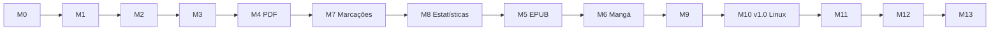
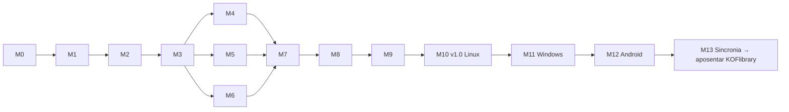

# Roadmap do Fierium

> Checklist dos marcos. Como cada marco é tocado (branch, portões de qualidade, definição de pronto, checkpoint):
> [PLANO.md](PLANO.md).
>
> **Cada marco termina num checkpoint (CP):** eu paro, entrego (comando, roteiro do que conferir, prints, testes) e
> você testa. Só sigo depois do teu "segue".
>
> **Quem faz (D27):** a sessão principal orquestra; os passos viram **cartões** pra agentes executores (Codex,
> outras sessões do Claude). Como funciona: [ORQUESTRACAO.md](ORQUESTRACAO.md). 🧭 = do orquestrador; 🤖 = cartão.
>
> Estado: ⬜ não começou · 🟨 em andamento · ⏸ esperando você testar · ✅ aprovado

## Visão geral

**Ordem combinada com o Marcelo (08/11):** depois do PDF (M4) vêm as marcações (M7) e as estatísticas (M8), porque
ele lê mais PDF agora; EPUB (M5) e mangá (M6) vêm depois. **Linux desde o começo:** a partir do M2, todo checkpoint
entrega um pacote Linux pra testar.

| Ordem | Marco | Entrega | Versão | Estado |
|---|---|---|---|---|
| 1 | M0 | Fundação e plano | — | ✅ (feito) |
| 2 | M1 | Protótipo de interface + arquitetura modular | v0.1 | ⏸ |
| 3 | M2 | Tauri no Linux (pacote Linux desde aqui) | v0.2 | ⏸ |
| 3b | M1.5 | **Identidade de Fieri** (sonho, mundos, constelações; o selo novo) — [IDENTIDADE.md](IDENTIDADE.md) | v0.2.1 | 🟨 escolhido: B Céu antigo + selo Astrolábio (D24); aplicando |
| 4 | M3 | Núcleo Rust e biblioteca de verdade | v0.3 | ⬜ (só planejado) |
| 5 | M4 | Leitor de PDF | v0.4 | ⬜ |
| 6 | M7 | Marcações, notas e ligações (no PDF) | v0.5 | ⬜ |
| 7 | M8 | Estatísticas e metas reais | v0.6 | ⬜ |
| 8 | M5 | Leitor de EPUB | v0.7 | ⬜ |
| 9 | M6 | Leitor de mangá e HQ | v0.8 | ⬜ |
| 10 | M9 | Backup e importar o KOFlibrary | v0.9 | ⬜ |
| 11 | M10 | Lançamento Linux | v1.0 | ⬜ |
| 12 | M11 / M12 / M13 | Windows / Android / Sincronia → aposentar o KOFlibrary | v1.1–1.3 | ⬜ |

---|---|---|---|---|
| M0 | Fundação e plano | — | P | 🟨 |
| M1 | Protótipo de interface (navegador, biblioteca de exemplo) | v0.1 | G | 🟨 |
| M2 | Prova técnica: Tauri no Linux (e um APK de teste) | v0.2 | M | ⬜ |
| M3 | Núcleo Rust e biblioteca de verdade | v0.3 | G | ⬜ |
| M4 | Leitor de PDF | v0.4 | G | ⬜ |
| M5 | Leitor de EPUB | v0.5 | M | ⬜ |
| M6 | Leitor de mangá e HQ (CBZ, CBR) | v0.6 | M | ⬜ |
| M7 | Marcações, notas e ligações | v0.7 | G | ⬜ |
| M8 | Estatísticas e metas | v0.8 | M | ⬜ |
| M9 | Backup, exportar/importar e importar o KOFlibrary | v0.9 | M | ⬜ |
| M10 | **Lançamento Linux** (pacote + atualização assinada) | **v1.0** | M | ⬜ |
| M11 | Windows | v1.1 | M | ⬜ |
| M12 | Android | v1.2 | G | ⬜ |
| M13 | Sincronia PC ↔ celular → **aposentar o KOFlibrary** | v1.3 | G | ⬜ |

Tamanho: P (uma sessão), M (duas ou três), G (várias).

---

## M0 — Fundação e plano ✅

**Objetivo:** projeto organizado antes de qualquer tela.

- [x] Monorepo pnpm (`apps/`, `packages/`, `docs/`), TypeScript estrito, ESLint com regra de camadas, Prettier
- [x] `pnpm check` (formato, lint, tipos, testes)
- [x] CI do GitHub (Linux e Windows)
- [x] `.gitignore` barrando livros e chaves
- [x] Visão de produto, arquitetura, modelo de dados, decisões, plano de engenharia, este roadmap
- [x] `README.md`, `AGENTS.md`/`CLAUDE.md`, `docs/CONTRATOS.md`, `docs/JORNAL.md`, `docs/EXPANDIR.md`
- [ ] Repositório `Fierium` criado por você (vazio) e o primeiro push com o CI verde

**Aceite (CP0):** você aprova o PLANO e este ROADMAP; o CI roda verde no GitHub.

## M1 — Protótipo de interface ⏸

**Objetivo:** o app inteiro de cara, no navegador, com uma biblioteca de exemplo (40 obras de domínio público e duas
séries de mangá inventadas), pra aprovar o visual e a navegação **antes** de ligar o Rust.
**Fora do escopo:** teus arquivos de verdade (M3), PDF/EPUB/mangá de verdade (M4–M6).

Base
- [x] Contrato provisório: tipos e 20 comandos
- [x] Adaptador de exemplo em memória, imitando o Rust, guardando as mudanças entre recarregamentos
- [x] Testes da base (busca sem acento, marcações, estatísticas, guardar): 11 passando

Design system
- [x] Temas Noite e Claro; fontes embutidas (Fraunces, Inter, Literata); ícones; capas geradas; anel de progresso

Casca
- [x] Barra lateral (computador) e barra de baixo (celular)
- [x] Fundo com céu animado (para no movimento reduzido e com o leitor aberto)
- [x] Buscar (Ctrl+K): obras, autores, coleções, frases marcadas e comandos
- [x] Avisos de erro (código + mensagem em português)
- [x] Nomes simples na interface (D15): Início, Biblioteca, Coleções, Notas, Estatísticas, Ajustes, Buscar
- [x] Juntar a casca e o estilo das telas

Telas
- [x] Primeira abertura (escolher "biblioteca de exemplo"; "escolher pasta" chega no M3)
- [x] **Início**: continuar lendo, em andamento, uma marcação antiga que volta, nunca abertos, adicionados recentemente
- [x] **Biblioteca — grade/lista**: busca, filtros (estado, área, formato, favoritas), ordenar
- [x] **Biblioteca — mapa**: as obras como luzes agrupadas por área, brilho pelo progresso, arrastar e zoom
- [x] **Coleções**: lista, página da coleção com a cor dela, criar coleção
- [x] **Página da obra**: capa, dados, edições e arquivos, progresso, marcações, coleções, obras parecidas
- [x] **Leitor de demonstração** (Dom Casmurro de verdade): abertura animada, interface que some, temas (papel, sépia, noite, tinta), fonte, tamanho, entrelinha, largura
- [x] **Marcação no leitor**: selecionar → cor com significado → nota; mudar cor, apagar; painel das marcações do livro
- [x] **Notas**: todas as marcações, filtro por cor, busca, ligações, exportar Markdown
- [x] **Estatísticas**: hoje, semana, sequência, recorde, calendário do ano, últimos 30 dias, por área, metas
- [x] **Ajustes**: tema, movimento reduzido, padrões de leitura, cores das marcações, recomeçar o exemplo

Fechamento
- [x] Testes de fluxo (Playwright) com prints de computador e celular
- [ ] Prévia publicada pra você abrir sem instalar nada (vai junto com o pacote Linux do M2)

Arquitetura (pedido do Marcelo: "engenharia de software de verdade")
- [x] Uma pasta por funcionalidade (`recursos/`), cada uma com estado, telas, estilo e testes; o lint barra uma importar outra
- [x] Injeção de dependências (`Servicos`: cliente, log, eventos, relógio) e eventos tipados entre funcionalidades
- [x] Adaptador de exemplo dividido por área, igual às partes do Rust
- [x] `@fierium/leitores`: a tomada `MotorDeLeitura` + o motor de texto (sem React, testado com DOM falso)
- [x] `@fierium/diagnostico`: log central, rastro de cada comando (tempo e erro) e o inspetor (Ctrl+Shift+D)
- [x] Vitrine (`#/vitrine`, só em desenvolvimento) e testes de componente (balão de marcação)
- [x] Guia de como estender (`docs/EXPANDIR.md`)

**Aceite (CP1):** com `pnpm install && pnpm dev` (ou a prévia): achar um livro pela grade, pelo mapa e pela busca;
abrir a leitura e voltar pro mesmo lugar; marcar com duas cores, anotar, ver nas Notas e exportar; ver as
Estatísticas e criar uma meta; trocar pro tema Claro; tudo usável numa janela estreita (celular); recarregar e as
mudanças continuarem.

## M2 — Tauri no Linux ⏸

**Objetivo:** o Fierium abrindo como programa de verdade no Linux, com o núcleo Rust, antes de construir a biblioteca.

- [x] Workspace Rust: `fierium-core` (erros com código, log em arquivo por dia guardando 14 dias, leitura aos pedaços) e `fierium-app` (Tauri 2)
- [x] Porta única `chamar` com os mesmos nomes do contrato (`app.info`, `app.comandos`, `log.escrever`) — D21
- [x] Adaptador Tauri + **adaptador combinado** (o resto ainda vem do exemplo; cada área troca no M3) — D22
- [x] Log da interface indo pro arquivo do Rust (`~/.local/share/fierium/logs/`)
- [x] Protocolo `fierium://arquivo/<id>` com Range (só arquivos registrados, nunca caminho solto); testado com arquivo de 500 MB sem ler tudo
- [x] Permissões mínimas (só `core:default`) e CSP fechada
- [x] Ícone, `.deb` e AppImage; teste de fumaça do executável numa tela virtual (`ferramentas/fumaca-linux.sh`)
- [x] CI: job do núcleo no Linux (`fmt`, `clippy -D warnings`, testes)
- [ ] Medição do PDF grande no WebKitGTK → vai junto com o leitor de PDF (M4), que é quem lê pelo protocolo
- [ ] APK Android de teste → adiado pro M12 (o Linux vem primeiro, D23)

**Aceite (CP2):** você instala o `.deb` (ou roda o AppImage) no teu Linux e o Fierium abre com a biblioteca de
exemplo; o log do dia aparece em `~/.local/share/fierium/logs/`.

## M1.5 — Identidade de Fieri 🟨

**Objetivo:** o app com a cara do **Céu antigo** e o **selo Astrolábio** (D24), sem mudar o jeito de navegar.
Referência visual: os prints `docs/imagens/identidade/ceu-*.jpg` e `selos.jpg`; o protótipo em `ferramentas/identidade/`
(o selo B está em `selos.js → seloB`). 🤖 = dá pra passar pra outro agente (D26; veja "Trabalhar com outros agentes" abaixo).

- [x] I.0 Três direções e três selos em print; o Marcelo escolheu B + Astrolábio
- [x] I.1 **Tokens do Céu antigo** em `packages/ui/src/tokens.css` (noite azul `#0a0f1e`, ouro `#e2b866`, pergaminho
      `#f1e6c9`, raios finos, bordas gravadas), mantendo os nomes das variáveis que as telas já usam
- [x] I.2 🤖 **Fontes**: `@fontsource` de Cormorant Garamond e Cinzel em `packages/ui` (D25), variáveis
      `--fonte-titulo` e `--fonte-rotulo`. Pronto quando: `pnpm check` passa e o build não busca nada na internet
- [x] I.0b 🧭 Onda 0: o contrato do leitor ganha o tema `pergaminho` e a fonte `cormorant` (padrões novos)
- [ ] I.3 🤖 [cartão](cartoes/m1.5/i3.md) **Ícones do selo Astrolábio**: o componente já existe (`packages/ui/src/SeloFieri.tsx`, usado na barra
      lateral, no Início e na abertura). Falta: um teste de componente (grande × simples em ≤ 20 px), o ícone do app
      (`crates/fierium-app/icons/`: 32, 128, 256, `.ico`, `.icns`, sobre o fundo `#0a0f1e`) gerado por script a partir
      do mesmo desenho, e o `docs/imagens/selo-fieri.svg`. Pronto quando: os ícones saem do script (nada à mão),
      `pnpm check` e `pnpm check:rust` passam e o `.deb` mostra o ícone novo
- [ ] I.4 🤖 [cartão](cartoes/m1.5/i4.md) **Fundo de mapa celeste** em `apps/app/src/casca/Atmosfera.tsx` (canvas: paralelos e meridianos, eclíptica,
      estrelas, constelações com semente fixa; parado no movimento reduzido). Pronto quando: print igual ao protótipo e
      sem custo por quadro com o app parado
- [x] I.5 **Início = Limiar do Sonho** (selo, frase, a obra em leitura no astrolábio, "Continuar lendo", os mundos)
- [ ] I.6 🤖 [cartão](cartoes/m1.5/i6.md) **Capas e mundos**: moldura gravada dupla, foco em ouro, títulos em Cormorant e autor em itálico; mundos
      com losango (em `compartilhado/Obras.tsx` e nos chips). Pronto quando: os testes de componente passam e o print
      da Biblioteca bate com `ceu-biblioteca.jpg`
- [ ] I.7 🤖 [cartão](cartoes/m1.5/i7.md) **Leitor em pergaminho**: página clara com moldura, capitular, marca-texto em ouro, notas com borda
      gravada e o progresso num anel (em `recursos/leitor/leitor.css`); Literata continua como opção nos Ajustes
- [ ] I.8 🤖 [cartão](cartoes/m1.5/i8.md) Transição de abrir obra: o anel do astrolábio gira e a página se abre em luz (interrompível; nada no
      movimento reduzido)
- [ ] I.9 🧭 Prints novos no README, `pnpm check` + `pnpm e2e` + `pnpm check:rust`, pacote Linux

**Aceite (CP1.5):** você instala o pacote e o app tem a cara do Céu antigo: Início, Biblioteca e leitor batendo com os
prints escolhidos, o selo novo no ícone e na abertura. Depois segue o M3.

**Ondas (D27):** onda 1 = I.3, I.4, I.6 e I.7 juntos (não se tocam) → onda 2 = I.8 (cartão) → onda 3 = I.9 🧭 e o CP1.5.
Detalhes e o esboço das ondas do M3 em [ORQUESTRACAO.md](ORQUESTRACAO.md#ondas-planejadas).

## M3 — Núcleo Rust e biblioteca de verdade ⬜

> Cartões e ondas: [cartoes/m3/ONDAS.md](cartoes/m3/ONDAS.md) (13 cartões; a onda 0 é do orquestrador).

**Objetivo:** a tua pasta de livros de verdade dentro do Fierium.

- [x] SQLite com migrações numeradas e testadas (migração inicial)
- [ ] Modelo obra → edição → arquivo; UUIDv7; registro de mudanças e relógio lógico (pronto pra sincronia)
- [x] Escolher pastas; varrer; perceber arquivo novo, movido e apagado
- [x] Identidade do arquivo pelo conteúdo (BLAKE3)
- [ ] Capa, título, autor, ano e série de PDF, EPUB e CBZ/CBR (e pelo nome do arquivo)
- [ ] Reconhecer obra e série; juntar e separar à mão
- [ ] Busca (FTS5): títulos, autores, assuntos, notas
- [ ] Coleções no banco
- [ ] Front ligado ao Rust (o exemplo continua pro `pnpm dev` e os testes)
- [ ] Teste de contrato (exemplo × Rust) e teste com 2.000 arquivos gerados

**Aceite (CP3):** tua pasta aparece com capas e títulos certos; renomear e mover um arquivo não perde nada; a busca
acha por autor sem acento; abrir com 2.000 arquivos cumpre o orçamento.

## M4 — Leitor de PDF ⬜

> Cartões e ondas: [cartoes/m4/ONDAS.md](cartoes/m4/ONDAS.md) (8 cartões; o motor sozinho na onda 1).

- [x] pdf.js recebendo aos pedaços (inclui transporte Range explícito no `fierium://`); desenha só as páginas perto da tela
- [ ] Zoom (largura, página inteira, livre), página dupla
- [ ] Sumário e busca no livro
- [ ] Cortar margens
- [ ] Temas que repintam a página (o Pintor do KOFlibrary, reescrito), brilho, contraste, luz quente
- [ ] Posição exata salva
- [ ] PDF escaneado (JPEG 2000, JBIG2)

**Aceite (CP4):** teus PDFs grandes e escaneados abrem no orçamento; tema noite repinta sem estragar figuras; fechar
e abrir volta na mesma página.

## M5 — Leitor de EPUB ⬜

- [x] epub.js (versão fixa) lendo o arquivo pela URL do Rust
- [ ] Fonte, tamanho, entrelinha, margens, justificar; página ou rolagem; colunas na tela larga
- [ ] Temas de leitura; sumário; busca no livro
- [ ] Posição exata (CFI)

**Aceite (CP5):** teus EPUBs abrem com capa, sumário e as tuas preferências; mudar a fonte não perde a posição.

## M6 — Leitor de mangá e HQ ⬜

- [ ] CBZ lido aos pedaços; CBR (biblioteca com licença compatível — R3)
- [ ] Direita → esquerda (padrão), esquerda → direita, vertical
- [ ] Página dupla na tela larga; capa e página larga sozinhas
- [ ] Séries em ordem (volume/capítulo), "próximo capítulo" no fim
- [ ] Cortar bordas brancas; temas
- [ ] Pré-carregar as próximas páginas sem estourar a memória

**Aceite (CP6):** uma série tua em CBZ e CBR na ordem certa; virar página < 100 ms; chegar no fim abre o próximo.

## M7 — Marcações, notas e ligações ⬜

- [ ] Marca-texto no PDF e no EPUB (âncora que resiste a fonte e zoom); marcação de região no mangá
- [ ] Cores com significado que você define
- [ ] Nota na marcação; ajustar as pontas arrastando
- [ ] Marcador de página e nota solta
- [ ] Ligar uma marcação a outra (até de outro livro)
- [ ] Tela de Notas com os dados reais: busca, filtros, ir pro trecho
- [ ] Exportar Markdown

**Aceite (CP7):** marcar e anotar num PDF e num EPUB; mudar a fonte do EPUB e a marcação continuar no lugar;
ligar com outro livro; exportar e abrir o Markdown.

## M8 — Estatísticas e metas ⬜

- [ ] Sessões reais (só conta lendo de verdade)
- [ ] Diário por dia e por aparelho (sem contar duas vezes)
- [ ] Sequência (hoje sem leitura não quebra), recorde
- [ ] Metas que você escolhe (período, o quê, quanto), várias
- [ ] Calendário do ano, últimos 30 dias, por área, horário favorito, tempo restante pelo teu ritmo
- [ ] Retrospectiva do mês/ano

**Aceite (CP8):** uma semana de uso real batendo com o que você leu.

## M9 — Backup, exportar/importar e importar o KOFlibrary ⬜

- [ ] Backup automático dos dados pessoais (guarda os últimos N)
- [ ] Exportar e importar tudo (formato aberto e versionado, que junta sem estragar; importar duas vezes não duplica)
- [ ] Importar o `.koflib`: progresso, notas, marcadores, estatísticas
- [ ] Teste com backups do KOFlibrary gerados pelos testes

**Aceite (CP9):** o teu backup do KOFlibrary entra e você continua de onde parou nos teus livros.

## M10 — Lançamento Linux (v1.0) ⬜

- [ ] AppImage (e avaliar Flatpak)
- [ ] Atualização automática assinada; chave só no segredo do CI
- [ ] Lançar = tag + CI (nunca push na main)
- [ ] Ícone, entrada no menu, nome e versão no "Sobre"
- [ ] Revisão de acessibilidade (teclado, contraste, movimento reduzido) e de desempenho (PLANO §5.3)

**Aceite (CP10):** instalar pelo pacote, usar uma semana, receber uma atualização sozinho.

## M11 — Windows (v1.1) ⬜

- [ ] Instalador e versão portátil, assinados; CI gerando
- [ ] Testes de fluxo também no Windows

**Aceite (CP11):** instalar e usar num Windows de verdade.

## M12 — Android (v1.2) ⬜

- [ ] APK pelo Tauri, assinado com chave fora do repositório
- [ ] Pastas pelo seletor do Android; "Abrir com"
- [ ] Telas e gestos de celular; teclas de volume viram página
- [ ] Desempenho com PDF grande e mangá no celular

**Aceite (CP12):** no teu celular, ler PDF, EPUB e mangá das tuas pastas.

## M13 — Sincronia PC ↔ celular (v1.3) ⬜

- [ ] Pareamento seguro (segredo longo/QR, limite de tentativas, ligada só quando pedir)
- [ ] Juntar progresso, marcações, notas, coleções e estatísticas (as regras do modelo de dados)
- [ ] Mandar livros do PC pro celular
- [ ] Conflito de nota de verdade mostrado pra você escolher

**Aceite (CP13):** ler no PC, continuar no celular, voltar pro PC e tudo igual. **Paridade com o KOFlibrary
conferida → o KOFlibrary é aposentado** (o README dele aponta pro Fierium).

## Depois

Mapa completo e descoberta, webtoon, audiolivro, catálogos de domínio público, iOS, versão web, contas opcionais,
nomes da identidade do Fierium na interface (D15).
