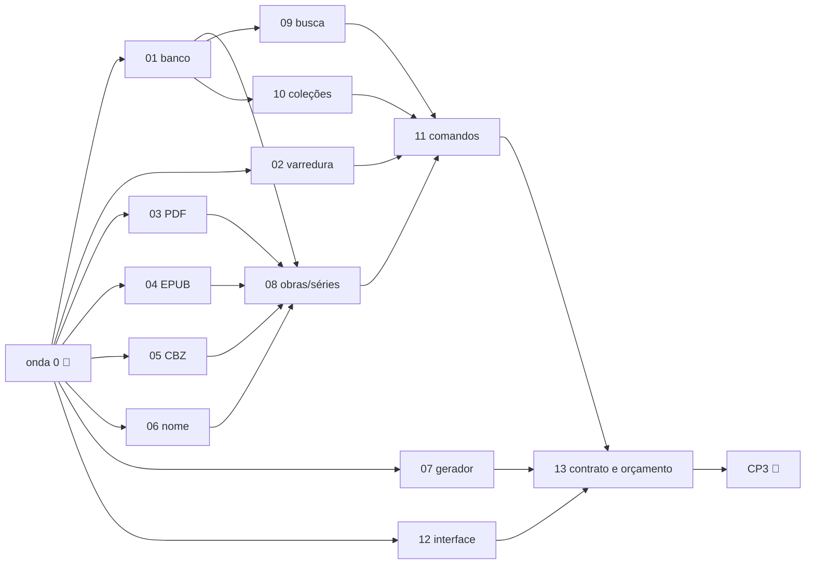

# M3 · ondas e cartões

Branch do marco: `marco/m3` (criada pelo orquestrador na onda 0, a partir do M1.5 aprovado).

## Onda 0 (🧭 orquestrador, antes de despachar)

- [ ] Criar `marco/m3`
- [ ] Crates `fierium-dados` e `fierium-biblioteca` (esqueleto, `lib.rs` com os módulos vazios, no workspace)
- [ ] Dependências: rusqlite (bundled, FTS5), uuid (v7), blake3, walkdir, zip, quick-xml, lopdf, tauri-plugin-dialog;
      decidir a biblioteca de RAR (licença) ou adiar o CBR
- [ ] Tipos comuns: `Metadados`, `ArquivoAchado`, `ArquivoConhecido`, `Mudanca`, erros novos (`ARQUIVO_ILEGIVEL`, `ARQUIVO_PROTEGIDO`)
- [ ] Contrato: `pastas.listar/adicionar/remover`, `biblioteca.varrer`, eventos `biblioteca.progresso`/`biblioteca.mudou`,
      `fierium://capa/<id>` em `packages/contratos` e `docs/CONTRATOS.md`
- [ ] `pnpm check` e `pnpm check:rust` verdes na `marco/m3`

## Ondas

| Onda | Cartões (em paralelo dentro da onda) |
|---|---|
| 1 | [01 banco](01-banco.md) · [02 varredura](02-varredura.md) · [03 PDF](03-metadados-pdf.md) · [04 EPUB](04-metadados-epub.md) · [05 CBZ/CBR](05-metadados-cbz.md) · [06 nome](06-nome-do-arquivo.md) · [07 gerador](07-gerador-de-teste.md) |
| 2 | [08 obras e séries](08-obras-e-series.md) · [09 busca](09-busca.md) · [10 coleções](10-colecoes.md) |
| 3 | [11 comandos do app](11-comandos-app.md) · [12 interface das pastas](12-front-pastas.md) (dá pra começar na onda 2, com o exemplo) |
| 4 | [13 contrato e orçamento](13-contrato-e-orcamento.md) |
| 5 🧭 | integração, prints, pacote Linux, JORNAL, **CP3** |

